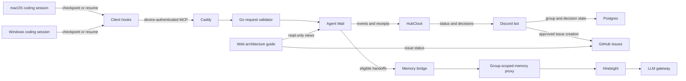
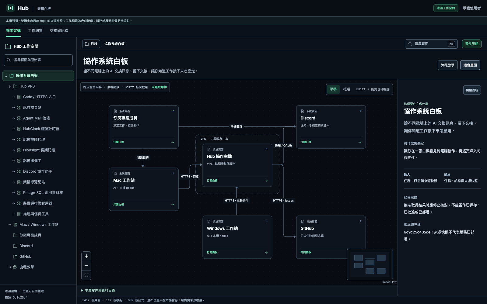

# Don't be a meat proxy

**Hub connects AI coding sessions across machines so people can review decisions instead of copying messages between terminals.**

A coding agent can finish its part of a task and exit while the next agent is working elsewhere. Without a shared inbox, someone has to copy the handoff, explain where it came from, and check that it arrived. Hub gives sessions a durable place to leave and pick up that context, and gives the operator a way to follow progress and approve decisions.

## How it works



- **Durable handoffs.** Client hooks stage unread messages locally and use receipts and idempotency keys to handle retries.
- **Progress and decisions in Discord.** Check status, receive notifications, and confirm decisions or issue creation with the authorized account.
- **Group-scoped memory.** The memory bridge indexes eligible handoffs. The proxy resolves the bank from the authenticated group and enforces budgets.
- **Architecture workbench.** Follow a handoff, navigate from services to functions, and inspect allowed source excerpts on a desktop or phone.

### Architecture workbench

The screenshots show the local demo. The flow is a walkthrough, and the demo work items are synthetic.



[Handoff walkthrough](docs/ui/tech-desktop-flow.png) · [Mobile overview](docs/ui/tech-mobile-overview.png)

## Try it locally

Install Node.js 22 and run the following from a checkout. The demo uses the tracked source to build the architecture map and starts a loopback-only server with sample work items.

```bash
npm ci --prefix web --ignore-scripts
DEMO_PORT=8084 npm run demo --prefix web
```

Open [the local demo](http://127.0.0.1:8084/) and select **Mac → Windows** in the page tree to follow a handoff. The demo needs no account or API key.

See the [client setup](client/README.md), [web guide](web/README.md), and [deployment runbook](docs/ops/runbook-L09-launch-deploy.md) for the service configuration.

## Test

The [CI workflow](.github/workflows/ci.yml) has the commands for all credential-free suites. To start with the client and web app:

```bash
node --test client/test/*.test.mjs
npm ci --prefix web --ignore-scripts
npm test --prefix web
```

CI also covers the Discord bot, LLM gateway, memory bridge, bank proxy, acceptance harness, HubClock, classification evaluator, Python operations, and Go validator. It uses loopback or in-process fixtures. Native Agent Mail tests self-skip when their binary is unavailable. The Python job enables an explicit skip for tests that start or configure Docker services.

## Stack

| Area | Implementation |
| --- | --- |
| Client and services | Node.js 22, JavaScript modules, MCP over HTTP |
| Mail and lifecycle | MCP Agent Mail, HubClock, SQLite-backed Mail |
| Web guide | React Flow, esbuild, Node HTTP server |
| Identity and state | Discord OAuth and bot, PostgreSQL, GitHub REST API |
| Memory and model routing | Hindsight, pgvector, provider gateway |
| Ingress and operations | Caddy, Go validator with Gitleaks rules, Python, Docker Compose, systemd |

## Security design

- Device bearer tokens are revocable. The ingress validator scans supported write fields for credential patterns and blocks unsupported payloads.
- Discord accounts map to group membership and roles. GitHub writes and decision confirmations require an authorized user action.
- Group-scoped storage and memory routing bind each request to the authenticated group. Rate and budget limits constrain upstream model calls.
- The web workbench reads vetted source paths. Private configuration and runtime state stay outside Git. See [the security policy](SECURITY.md) for reporting.

## How we built it

Orca was the development coordination layer. A PM agent dispatched scoped work to Claude, Codex, and Antigravity in separate worktrees. Workers reported the commit, checks, and remaining acceptance work to the PM. Test-driven changes began with a failing behavior check, added the smallest implementation, and reran the relevant suites. Reviews and merges recorded what had been verified locally and what required a real deployment or a human check.

The [requirements](docs/03-srs.md), [architecture](docs/04-sad.md), [test plan](docs/06-test-plan.md), and Git history show how those decisions changed as the team learned more.

## Roadmap

- Complete live macOS and Windows handoff acceptance, Discord sign-in and notifications, and the backup restore drill.
- Refine client installation and upgrades for additional machines.
- Measure memory retrieval quality with representative handoffs and review the model budget using real workloads.

## 中文簡介

Hub 把不同電腦上 AI 助手的交接、狀態和待確認決策集中起來。前一個 session 可以把進度存進共同信箱，下一個 session 開始時接續工作。操作者能在 Discord 查看狀態並確認需要人工核准的動作，也能在架構白板追蹤一次交接經過哪些服務。上方本機 Demo 使用合成資料，不需要 Discord 帳號或 API 金鑰。

[MIT license](LICENSE)
