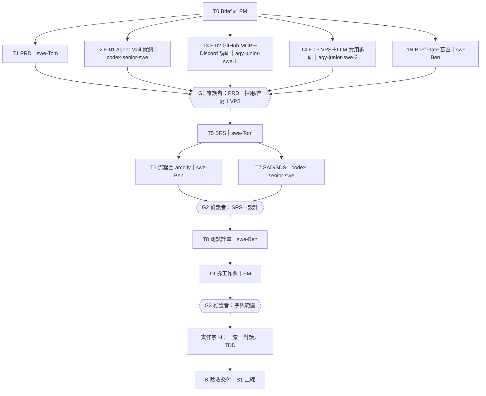
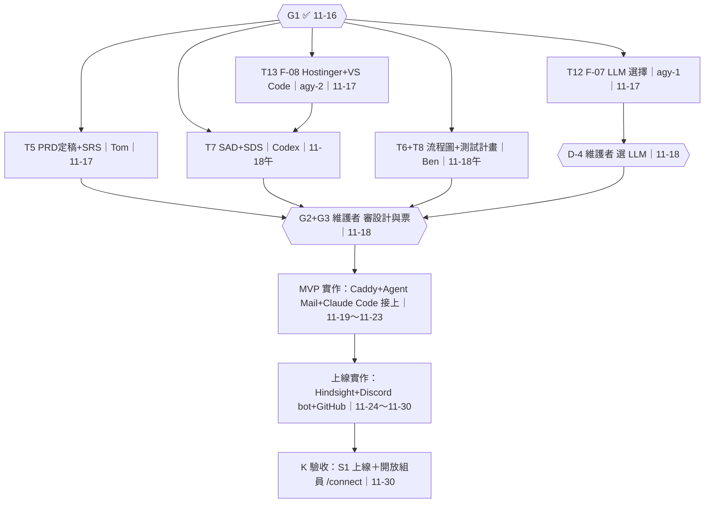

# 工作 DAG 與派工

- PM：PM-Emily｜決策人：維護者｜流程：專案開發流程（`/project`）
- 最後更新：2026-11-17
- 規則：所有正式文件最後都放在**本專案資料夾 `docs/`**。worker 先寫在自己的 worktree，PM 審查後再收進來。
- Gate（G1–G3）一律由 維護者 審查；Gate 沒通過，下游的票不會開出去。

## 任務表

| ID | 專案流程階段 | 產出（收入本資料夾） | 負責 | 依賴 | 狀態 |
|---|---|---|---|---|---|
| T0 | A 需求訪談 | `docs/01-brief.md` | PM | — | ✅ 已確認 |
| T1 | B PRD | `docs/02-prd.md` | swe-Tom（Claude） | T0 | Wave 1 |
| T1R | Brief 審查 | `docs/reviews/T1R-brief-review.md` | swe-Ben（Claude） | T0 | Wave 1 |
| T2 | feasibility | `docs/research/F-01-agent-mail-spike.md` | codex-senior-swe（Codex） | T0 | Wave 1 |
| T3 | feasibility | `docs/research/F-02-github-discord.md` | agy-junior-swe-1（Antigravity） | T0 | Wave 1 |
| T4 | feasibility | `docs/research/F-03-vps-llm-cost.md` | agy-junior-swe-2（Antigravity） | T0 | Wave 1 |
| G1 | Gate | 維護者 決定 D-1（採用／自寫）、D-2（VPS），並確認 PRD | 維護者 | T1–T4、T1R | ✅ 2026-11-16 已決定 |
| T5 | C SRS | `docs/03-srs.md` | swe-Tom | G1 | 未開 |
| T6 | D 流程圖 | `docs/diagrams/` | swe-Ben | T5 | 未開 |
| T7 | E SAD/SDS | `docs/04-sad.md`、`docs/05-sds.md` | codex-senior-swe | T5 | 未開 |
| G2 | Gate | 維護者 確認 SRS 與設計 | 維護者 | T6、T7 | 未開 |
| T8 | F 測試計畫 | `docs/06-test-plan.md` | swe-Ben | G2 | 未開 |
| T9 | G 拆票 | `issues/`＋GitHub Issues | PM | T8 | 未開 |
| G3 | Gate | 維護者 確認票與範圍 | 維護者 | T9 | 未開 |
| H-* | H 實作 | 程式＋測試證據 | 依票分派 | G3 | 未開 |
| K | K 驗收 | `docs/delivery-S1.md` | PM＋reviewer | H-* | 未開 |

## 為什麼這樣分

- T2–T4 是 G1 的決策依據（Brief 的 A-1～A-3、D-1、D-2），所以和 PRD 平行進行。
- SAD/SDS（T7）依賴實測結果，因為「採用 Agent Mail」和「自寫」的架構不同。
- 拆票在測試計畫之後，符合專案流程「先決定怎麼驗，再拆票」。

## Orca 紀錄

Run、Task ID、Dispatch ID 由 PM 在派工後補在下方。

Run：`<ORCA_ID>`（2026-11-16 建立；舊的初始化 Run `<ORCA_ID>` 保留）。Dispatch 只能證明「已開始」，完成要以 `worker_done` 為準。

| 任務 | Task ID | Dispatch ID | Agent／worktree | 狀態 |
|---|---|---|---|---|
| T1 | <ORCA_ID> | <ORCA_ID> | claude／swe-Tom | ✅ succeeded，已收入 docs/02-prd.md（草稿） |
| T1R | <ORCA_ID> | <ORCA_ID> | claude／swe-Ben | ✅ succeeded，已收入 docs/reviews/T1R-brief-review.md |
| T2 | <ORCA_ID> | <ORCA_ID> | codex／codex-senior-swe | ✅ succeeded，已收入 docs/research/F-01（建議自寫，已被 維護者「能抄就抄」原則推翻，改由 T2b 驗證） |
| T3 | <ORCA_ID> | <ORCA_ID> | antigravity／agy-junior-swe-1 | ✅ succeeded，已收入 docs/research/F-02 |
| T4 | <ORCA_ID> → 修正 <ORCA_ID> | <ORCA_ID> | antigravity／agy-junior-swe-2 | ✅ 修正後通過（PM 已核對官方 Haiku 5.5 價格），已收入 docs/research/F-03 |

### 追加（維護者 原則：能參考的就抄，不要自己設計）

PM 盤點：`docs/research/F-04-oss-landscape.md`（OpenMausBot、Rakazo、Hindsight）。

| 任務 | 內容 | Task ID | Dispatch ID | Agent | 狀態 |
|---|---|---|---|---|---|
| T2b | V-1 Rust 版 Agent Mail＋一組一實例＋代理層撤銷 → F-01b | <ORCA_ID> | <ORCA_ID> | codex-senior-swe | ✅ succeeded（可原樣抄＋部署補洞），已收入 docs/research/F-01b |
| T10 | V-2 Hindsight 記憶層實測 → F-05 | <ORCA_ID> | <ORCA_ID> | swe-Ben | ✅ succeeded（需改造），已收入 docs/research/F-05 |
| T11 | V-3 可抄的 Discord 橋接專案 → F-06 | <ORCA_ID> | <ORCA_ID> | swe-Tom | ✅ succeeded，已收入 docs/research/F-06 |

G1 依賴改為：T1、T1R、T2、T3、T4 ＋ T2b、T10、T11。
| T4c | 補查 2 GB／4 GB VPS 價格 | <ORCA_ID> | <ORCA_ID> | agy-junior-swe-2 | ✅ succeeded，已併入 docs/research/F-03 |

## G1 之後：壓縮時程（MVP 11-23、上線 11-30）

維護者 在 G1 定下「一週 MVP、兩週上線」，所以原本串行的 T5 → T6／T7 改成**平行**：大家以 Brief＋PRD＋F-01～F-06 為共同上游，衝突標「待對齊」，由 PM 在 G2 收斂。G2 和 G3 合併成一次審查。

| 任務 | 內容 | Task ID | Dispatch ID | Agent | 期限 | 狀態 |
|---|---|---|---|---|---|---|
| T5 | PRD 定稿＋`docs/03-srs.md` | <ORCA_ID> | <ORCA_ID> | swe-Tom | 11-17 | ✅ succeeded，已收入 docs/02-prd.md、docs/03-srs.md（草稿；SRS 4.1 有 14 項待 維護者） |
| T7 | `docs/04-sad.md`、`docs/05-sds.md` | <ORCA_ID> | <ORCA_ID> | codex-senior-swe | 11-18 午 | ✅ 初稿已收入；回應 GAP 的修訂中 <ORCA_ID> |
| T6+T8 | `docs/diagrams/`、`docs/06-test-plan.md` | <ORCA_ID> | <ORCA_ID> | swe-Ben | 11-18 午 | ✅ succeeded，已收入（5 張圖、21 個 TC、GAP-01～22） |
| T12 | `docs/research/F-07-llm-provider.md` | <ORCA_ID> | <ORCA_ID> | agy-junior-swe-1 | 11-17 | ✅ 兩次退回後通過，已收入 docs/research/F-07 |
| T13 | `docs/research/F-08-hostinger-vscode.md` | <ORCA_ID> | <ORCA_ID> | agy-junior-swe-2 | 11-17 | ✅ succeeded，已收入 |

實作需要 維護者 提供（11-19 前）：VPS 的 SSH 登入方式（或由 維護者 本人執行指令）、VPS 上目前有沒有在跑其他服務、是否有自己的網域。

### 設計收斂（2026-11-16）

- T7 經兩次追加對齊為 v0.3（<ORCA_ID>、<ORCA_ID>），已收入 `docs/04-sad.md`、`docs/05-sds.md`。
- T9（PM）：`docs/07-tickets-mvp.md`（H-01～H-08）。
- G2+G3 審查包：`docs/gates/G2G3-review.md`，✅ 2026-11-17 維護者 全部照建議核准。

## MVP 實作（G2+G3 ✅ 2026-11-17；docs checkpoint d0a8d63）

| 票 | Task ID | Dispatch ID | Agent | 期限 | 狀態 |
|---|---|---|---|---|---|
| H-01 runbook＋Hostinger MCP 代做 DNS／防火牆 | <ORCA_ID> | <ORCA_ID> | codex-senior-swe | 11-19 | runbook ✅（719b04a）；PM 已用 Hostinger MCP 加 hub A 記錄並驗證 ✅；發現 VPS 已有 Caddy（office.example.invalid）占 80/443、無 Hostinger 防火牆；維護者 SSH 盤點 ✅；H-01 完成 |
| H-03 mail-client | <ORCA_ID> | <ORCA_ID> | swe-Tom | 11-20 | ✅ succeeded，PM 重跑 48/48 通過，已 ff 進 master（7f4a6e8）。偏差（PM 接受，上線批次前回寫 SRS/SDS）：真實送出回執格式與 SDS 文字不同；新增工程錯誤碼 E-CONFLICT、E-CURSOR；密鑰長度閾值版本 2026-11-17.1；整合測試用本機 binary 而非容器 |
| H-04a asyncRewake spike | <ORCA_ID> | <ORCA_ID> | swe-Ben | 11-19 | ✅ succeeded（f30ad4b，已併入 master），PM 重跑 9/9；結論部分可行：閒置 1.3–1.4 秒，忙碌時排到目前這一步結束 |
| H-07 接入手冊＋轉貼紀錄表 | <ORCA_ID> | <ORCA_ID> | agy-junior-swe-2 | 11-21 | ✅ 初稿 succeeded（605ea75），PM 修正後收入 docs/onboarding-S1.md、docs/metrics/G-01-paste-log.md；H-02／H-04 定稿後補實際值 |
| H-04 hub-hook | （follow-up） | <ORCA_ID> → 收尾 <ORCA_ID> | swe-Ben → codex-senior-swe | 11-22 | ✅ 已併入 master（e7f74de）：Ben 用量上限後由 Codex 收尾；PM 重跑單元 36、整合 5（TC-02/04/13、session.closed、問答）全過；Ben 用量恢復後用真 Claude 雙 session 驗 TC-02 4/4、TC-06 5/5、權限提示，fb11b9f 併入（e64fa1a），PM 重跑 98/98；Windows 留 H-08 |
| H-02 部署 mail-a（沿用系統 Caddy） | <ORCA_ID> | <ORCA_ID> | codex-senior-swe | 11-20 | ✅ 程式＋runbook succeeded（b42e7ef/d33d2d8，已併入 master bf983c4）；PM 重跑 ops/test 7 OK、local-stack 1 次 flaky＋1 次全 PASS → 已請 Codex 補 readiness 等待；**VPS 實機部署 ✅ 2026-11-17**：hub.example.invalid 上線、office 不受影響，實機 TC-01／05／10／11 通過，HubClock（SandyThrush）運作中 |
| H-06 備份/還原/到期刪除（先對本機做） | <ORCA_ID> | <ORCA_ID> | agy-junior-swe-1 | 11-22 | ✅ succeeded（c9bb154，已併入 master），PM 重跑還原演練通過（3 則原文 sha256 一致、purge dry-run／日期防線）；H-02 定稿後對齊 VPS 路徑 |
| H-05 ops/lifecycle | <ORCA_ID> | <ORCA_ID> | swe-Tom | 11-22 | ✅ succeeded（651edf3，已併入 master），PM 重跑單元＋整合 31/31；對齊項已轉給 H-02／H-04／H-06 |
| T14 F-10 InsForge 評估（維護者 建議參考） | <ORCA_ID> | <ORCA_ID> | agy-junior-swe-1 | 11-19 | ✅ succeeded，PM 抽查屬實，已收入 docs/research/F-10；結論 (b)：不進主系統，推薦給組員做團隊專題後端 |
| T15 Supabase 規格資料層（維護者 2026-11-17：照 Supabase 規格、先不跑整套；MVP 照舊） | <ORCA_ID> | <ORCA_ID> | swe-Tom | 11-18 | ✅ succeeded（d8d495a，已併入 master），PM 用 postgres:17 獨立重跑 11/11 PASS；待對齊項見 docs/08 §8 |

| H-08 MVP 驗收 | — | TC-13 前置 <ORCA_ID>；TC-08 修正 <ORCA_ID> | PM＋維護者；codex-senior-swe；swe-Ben | 11-23 | ✅ 2026-11-17 TC-01～13 全過（見 docs/delivery-MVP.md）；TC-08 經 9a1f78f 修正後重測通過 |
| L-00 MVP 顯示修正 | <ORCA_ID> | <ORCA_ID> | swe-Tom | 11-24 | ✅ fe3295b 併入 master（0cdbf4b）；PM 重跑 client 105（92 pass／13 skip 需本機 Mail）、lifecycle 0 fail；Mac 實機 #44 顯示「回覆」、#72 顯示「HubClock 通知：已拒絕」；Windows 待下次換檔 |
| L-01 Postgres＋Supabase migrations | <ORCA_ID> | <ORCA_ID> | codex-senior-swe | 11-25 | ✅ 68e9c3b 併入 master（85c6a7f），本機 155 測試 0 fail；**VPS 部署 ✅ 2026-11-17 08:10Z**（PM 照 runbook-L01）：4 migrations＋重跑冪等、RLS 14 PASS、hub_app 只能連 hub、無 5432 監聽、idle 50 MiB／512 MiB、office 200／hub 401、mail-a／hubclock 未重建；每日備份含 pg_dump（systemd 實跑 success）、還原演練 4 migrations／9 RLS 表／權限 f|f |
| L-06 auto mode | <ORCA_ID> | <ORCA_ID> | swe-Ben | 11-27 | 🔄 程式完成併入 master（0bbc74b，與 L-00 測試衝突由 PM 保留兩邊）；PM 重跑 client 113（100 pass／13 skip）、lifecycle 46（36 pass）0 fail；**HubClock 已部署 VPS 08:15Z**（state 備份 /root/hubclock-state.pre-L06）；實機 TC-15：無對象 #73→#75 拒、300 分鐘 #74→#76 拒、無生效 grant ✅；其餘步驟待 Windows。已知顯示問題：auto 通知寫「對 #null」。PM 接受 §5 取捨（到達時判斷、只放行 intent=action、一次一個對象）；同 dispatch 續派 L-02 → **L-02 ✅ 程式併入 master**（Hindsight 1.2.1＋bank-proxy＋LLM gateway；PM 重跑 client 101／lifecycle 36／bank-proxy 25／python ops 0 fail；Ben e2e 10/10、TC-21 sha256 一致、Hindsight 尖峰 1660 MiB）；未部署：需 維護者 的 Anthropic API key；續派 L-02b Mail→Hindsight bridge（GAP-16）→ **L-02b ✅ 併入 master**（PM 重跑 bridge 16/16、client 103 0 fail；Ben 黑箱 7/7：停 HS→pending→reindex 補回、同 document_id 為取代、超額不丟資料）；未部署 |
| L-07 伺服器端 validator | <ORCA_ID> | <ORCA_ID> | codex-senior-swe | 11-27 | ✅ 5bcb3ce 併入 master（f9a96c2）：Caddy→validator(Go, gitleaks v8.30.1)→mail-a；Codex 收據 Go 12/12、npm 45/45、整合 23/23、p95 8.8 ms；PM 重跑 client 101、bot 56、hub_ops OK，Go 測試因 golang proxy 網路錯誤未在 PM 端重跑；未部署。續派 L-08 |
| L-03 Discord bot | <ORCA_ID> | <ORCA_ID> | swe-Tom | 11-27 | ✅ 程式 21bb2ad 併入 master（f892509），PM 重跑 bot 44/44；未部署：需 維護者 建 Discord application；**L-03b TokenApplier ✅** 1082a08 併入 master，PM 重跑 token_applier 15/15、hub_ops 7 OK（1 skip）；VPS 部署（含 import-mvp、Caddy reload）與 bot 一起做 |
| L-04 Discord 建 GitHub Issue | <ORCA_ID> | <ORCA_ID> | agy-junior-swe-2 | 11-28 | ✅ 33a5143 併入 master，PM 重跑 bot 56/56；未部署：需 GitHub token（維護者）＋ register-commands |
| L-05 決策草稿→正式 | <ORCA_ID> | <ORCA_ID> → <ORCA_ID> | agy-junior-swe-1 | 11-28 | ✅ 8832b89 併入 master（agy-1 解 bot 衝突，PM 解 client 測試衝突）；PM 重跑 bot 64/64、client 118（105 pass／13 skip）0 fail；未部署 |
| L-08 跨組隔離 | <ORCA_ID> | <ORCA_ID> → 解衝突 <ORCA_ID>（原 <ORCA_ID> 因 worktree 有他人未提交 UI 工作改派） | codex（worktree codex-L08） | 11-29 | ✅ 1bb4aa6 併入 master：TC-14 本機 grp-test／grp-test2 全過（96 次跨組 401、附件 marker 無外洩、Hindsight／DB／決策隔離、TokenApplier）；PM 重跑 bot 64、client 105（13 skip）、bank-proxy＋bridge 42、python ops 0 fail；未部署 |
| UI 架構工作台（維護者 直接交給 Codex，非 PM 派工） | — | — | codex（worktree codex-senior-swe） | 11-30 | ✅ 本機完成：PM 於該 worktree 只提交 UI 相關檔到分支 example-org/ui-workbench（0dd3620，未含 spikes/、.playwright-cli/），併入 master d8c6996；PM 重跑 web 12/12、client 105（13 skip）、bot 64 0 fail。**未上線**：需部署 deploy/web＋Caddy /explorer.js 路由、正式 Discord OAuth、3 人新手測試 |
| L-09 上線部署總 runbook＋腳本 | <ORCA_ID> | <ORCA_ID> | codex（worktree codex-L09） | 11-29 | ✅ 8abf7f3 併入 master：`docs/ops/runbook-L09-launch-deploy.md`、`ops/deploy-l09.sh` 7 段；假 VPS 演練 STEP 1～7 PASS、Caddy reload 1 次；Mail／HubClock 在 STEP 4 維護窗各重建一次。**VPS 部署 ✅ 2026-11-18 ~01:10–01:40Z（PM，source 7216fee）**：STEP 1～7 全 PASS；9 份 migration；Groq 真 smoke 4/4 PASS（繁中 799ms、function call 301ms、Hindsight retain＋recall 4.5s、scratch bank 已刪）；9 服務 running restart=0；Caddy reload 1 次；office 200；guild 指令 /connect /revoke /status /task；備份 /root/neighbor-hub.pre-L09-20261118T010927Z |
| Discord application | <ORCA_ID> | <ORCA_ID> | codex（computer use）＋維護者（建立、CAPTCHA、身分驗證） | — | ✅ App ID <APPLICATION_ID>；token 存 Mac ~/.config/hub-discord/bot.token（600，72 bytes，PM 驗格式未讀內容）；待 維護者 邀請進伺服器 |
| F-11 Gemini 訂閱當 LLM 後端 | <ORCA_ID> | <ORCA_ID> | codex（worktree codex-F11） | — | ✅（維護者 改選 Groq gpt-oss，續派 F-11b）7939a89 併入 master：`docs/research/F-11-gemini-subscription-backend.md`；gateway 可切 gemini-cli／antigravity-cli／gemini-api-free／gemini-api-paid，預設 disabled。結論：Gemini CLI 個人訂閱 2026-06-18 停用；Antigravity 條款第 6 點第三方存取有停權風險；免費 API 資料可被用於訓練；付費 3.1 Flash-Lite 約 US$3.15／月。**待 維護者 選** |
| UI 第三版（維護者：第二版太簡陋不合格） | <ORCA_ID> | <ORCA_ID> | codex（worktree codex-senior-swe） | 11-30 | ✅ 本機完成併入 master：五層＋流程播放＋原碼閱讀；13 服務／92 模組／541 函式／20 連線；PM 重跑 web 16/16、client 0 fail；截圖 docs/ui/atlas-*.png；待 維護者 驗收是否合格 |
| UI 第四版（維護者：Notion 式無限白板＋目錄） | <ORCA_ID> | <ORCA_ID> | codex（worktree codex-senior-swe） | 11-30 | ✅ 本機完成併入 master：React Flow（MIT）無限白板、巢狀頁、Notion 式目錄樹、麵包屑；PM 重跑 web 0 fail；截圖 docs/ui/board-*.png；預覽 http://127.0.0.1:8084/；待 維護者 驗收 |
| UI 第五版（維護者：深色科技風，參考 terax.app／insforge.dev） | <ORCA_ID> | <ORCA_ID> | codex（worktree codex-senior-swe） | 11-30 | ✅ f825412 併入 master：深色主題、hover 光暈、沿線光點、⌘K 命令面板、雙向高亮；文字對比最低 8.6:1；PM 重跑 web 19/19；截圖 docs/ui/tech-*.png、比較圖 tech-comparison.png；預覽 http://127.0.0.1:8085/；**維護者 2026-11-18 驗收合格** |
| F-11b Groq（gpt-oss）後端 | <ORCA_ID> | <ORCA_ID> | codex（worktree codex-F11） | — | ✅ 3819428 併入 master：groq-api backend＋原生 tool call＋OpenAI／Messages shim＋共用日限；PM 重跑 gateway 35、bot 65 0 fail；真 key smoke（ops/llm-gateway/groq-smoke.mjs）待 維護者 存 key；待查 Groq Console 的 Spend Limits／Data Controls（ZDR） |
| EVAL-01 question／action 分類評測 | <ORCA_ID> | <ORCA_ID> | agy-junior-swe-2 | 11-29 | ✅ 30 則 fixtures＋runner 併入 master，PM 重跑單元 10/10；真模型 claude CLI 第 1 次 30/30 正確（action→question 0、question→action 0%），收據 docs/ops/evidence/EVAL01-claude-cli-run1.md |
| EVAL-01 收件端判斷 question／action | <ORCA_ID> | <ORCA_ID> | agy-junior-swe-2 | 11-28 | ✅ 資料集 fixtures/eval-classify-v1.jsonl（30 則，10 Q/10 A/10 mixed）、評測 runner ops/eval/eval-classify.mjs、單元測試 10/10 PASS |

註：Codex worker 沒有 Hostinger MCP 工具（escalation <ORCA_ID>）→ DNS／防火牆改由 PM 端 Hostinger MCP 處理，Codex 只寫 runbook＋hPanel 手動備案。
| P-1 上線前閘門：全測試＋Go 重跑＋L-09 對 Groq 再演練 | <ORCA_ID> | <ORCA_ID> | codex（worktree codex-P1） | 11-18 | 🔄 97db946：全套 0 fail（Go 13/13 Docker）、L09 STEP1～7 exit 0；Postgres integration 2/8 紅燈 → P-1b <ORCA_ID> ✅ 3435c72：根因為舊測試（ledger=6、regex 漏 T10、fixture 清理），合計 475/0、skip 0；九份 migration 的 L09 STEP1～7 exit 0；併入 master |
| P-2 TC-16～21 VPS 驗收腳本＋checklist | <ORCA_ID> | <ORCA_ID> | codex（worktree codex-P2） | 11-18 | ✅ 56dbcd6 併入 master（c9c4c87）：ops/acceptance/ tc-14、16～21 腳本＋7 份 checklist（🟡 標 維護者 步驟）；PM 重跑 acceptance＋bot 65 0 fail；delivery-S1 改 Groq |
| P-3 上線前安全審查（交叉審查） | <ORCA_ID> | <ORCA_ID> → P-3b <ORCA_ID> | codex（worktree codex-P3） | 11-18 | ✅ 10 項發現，5 項阻擋全數本地修復（91b6959、1afbba2、68d901e、R-04 f105c33、R-05 7396bb6）；併入 master 704aa1f（safety config 兩邊保留）；PM 重跑 bot 72、client＋gateway＋acceptance 161 pass/13 skip、Python ops OK 0 fail。部署需先套第 9 份 migration＋bot canonical sender 私有副本（見 L09 runbook） |
| P-4 正式機 MemoryBridge 未收件（/status 無交接） | <ORCA_ID> | <ORCA_ID> | codex（worktree codex-P1） | 11-18 | 🔄 查根因中（#89 已保存但 bridge cursor=0） |
| P-5 上線後修 R-06～R-10 | <ORCA_ID> | <ORCA_ID> | codex（worktree codex-P5） | 11-19 | 🔄 派工中 |
| P-6 Windows 更新包＋onboarding 上線版 | <ORCA_ID> | <ORCA_ID> | codex（worktree codex-P6） | 11-19 | 🔄 派工中 |
| P-4 結果 | <ORCA_ID> | <ORCA_ID> | codex | 11-18 | ✅ 685ac4b 併入 master：根因為 Mac ~/hub-mac 的 client 是舊版（無 memory_agent auto-CC）；PM 同步 hub-hook/mail-client/lifecycle protocol（備份 ~/hub-mac/.bak-*），重送交接 #90 → bridge 02:40:56Z indexed（cursor 121）。#89 與 13 筆歷史交接回填未做（需另核准）；Windows 待 P-6 更新包 |
| P-6 結果 | <ORCA_ID> | <ORCA_ID> | codex | 11-18 | ✅ c6cd3c4＋26f78a2 併入 master：Windows 更新包 hub-win-L09-update.zip（sha256 5c3c7f8b…，24 檔＋SHA256SUMS，無秘密）＋手冊 docs/ops/windows-update-L09.md＋onboarding 上線版；PM 重跑 client 107 pass／13 skip；已上傳 Drive（zip 1HmgOcKQ…、手冊 1T5zMseq…）；待 維護者 Windows 換檔 |
| P-5 結果 | <ORCA_ID> | <ORCA_ID> | codex | 11-18 | ✅ R-06～R-10 各一 commit（bbd0c33…a85f3cf）併入 master；PM 重跑 bot 79、client＋gateway＋bridge＋acceptance 188 pass／13 skip 0 fail；未部署（下次部署帶上） |
| P-7 一行安裝＋自動更新（Mac/Win/Linux） | <ORCA_ID> | <ORCA_ID> | codex（worktree codex-P7） | 11-19 | 🔄 派工中（維護者：要給協作者用，不要 Drive 傳檔）；發佈點 hub.example.invalid/dist，部署需 Caddy reload，PM 另排 |
