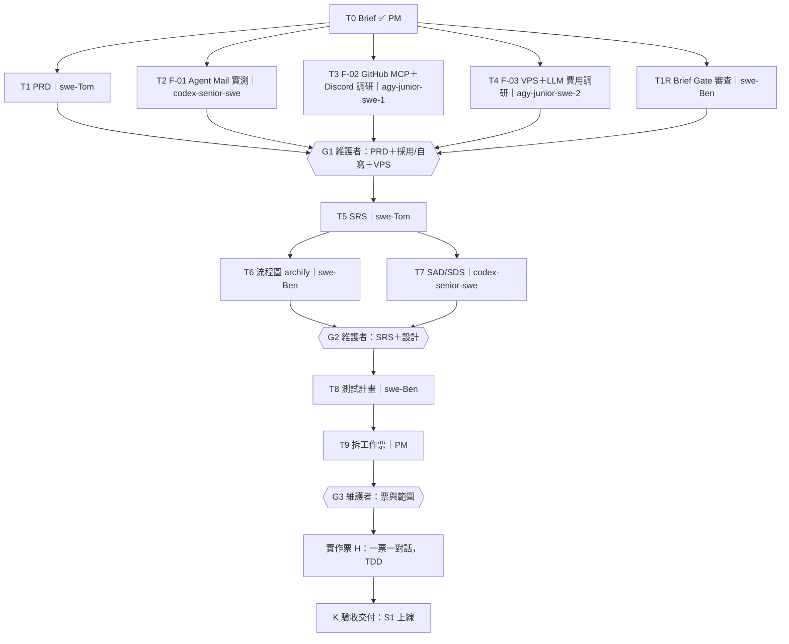
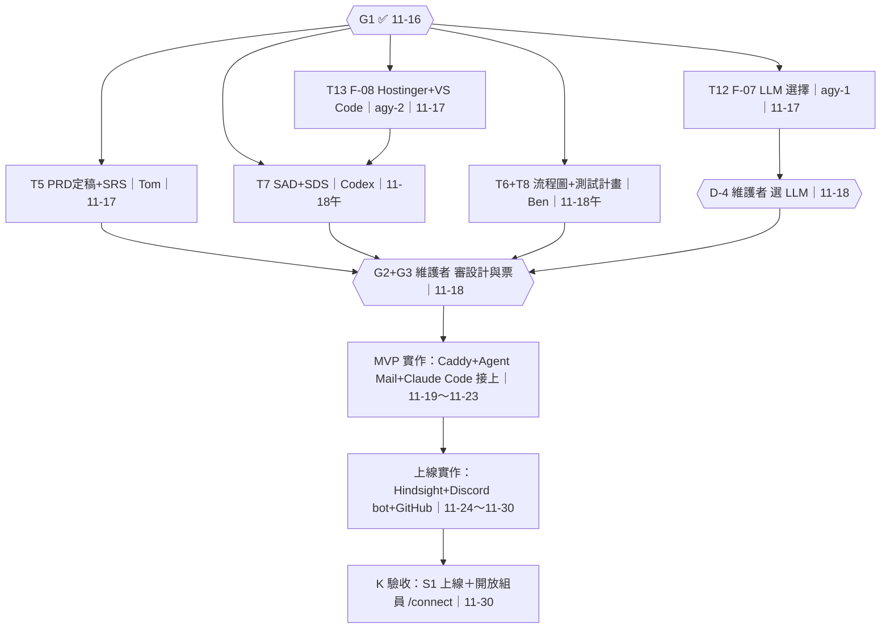

# 工作 DAG 與派工

- PM：PM-Emily｜決策人：維護者｜流程：專案開發流程（`/project`）
- 最後更新：2026-11-17
- 規則：所有正式文件最後都放在**本專案資料夾 `docs/`**。worker 先寫在自己的 worktree，PM 審查後再收進來。
- Gate（G1–G3）一律由 維護者 審查；Gate 沒通過，下游的票不會開出去。

## 任務表

| ID | 專案流程階段 | 產出（收入本資料夾） | 負責 | 依賴 | 狀態 |
|---|---|---|---|---|---|
| T0 | A 需求訪談 | `docs/01-brief.md` | PM | — | ✅ 已確認 |
| T1 | B PRD | `docs/02-prd.md` | swe-Tom（Claude） | T0 | Wave 1 |
| T1R | Brief 審查 | `docs/reviews/T1R-brief-review.md` | swe-Ben（Claude） | T0 | Wave 1 |
| T2 | feasibility | `docs/research/F-01-agent-mail-spike.md` | codex-senior-swe（Codex） | T0 | Wave 1 |
| T3 | feasibility | `docs/research/F-02-github-discord.md` | agy-junior-swe-1（Antigravity） | T0 | Wave 1 |
| T4 | feasibility | `docs/research/F-03-vps-llm-cost.md` | agy-junior-swe-2（Antigravity） | T0 | Wave 1 |
| G1 | Gate | 維護者 決定 D-1（採用／自寫）、D-2（VPS），並確認 PRD | 維護者 | T1–T4、T1R | ✅ 2026-11-16 已決定 |
| T5 | C SRS | `docs/03-srs.md` | swe-Tom | G1 | 未開 |
| T6 | D 流程圖 | `docs/diagrams/` | swe-Ben | T5 | 未開 |
| T7 | E SAD/SDS | `docs/04-sad.md`、`docs/05-sds.md` | codex-senior-swe | T5 | 未開 |
| G2 | Gate | 維護者 確認 SRS 與設計 | 維護者 | T6、T7 | 未開 |
| T8 | F 測試計畫 | `docs/06-test-plan.md` | swe-Ben | G2 | 未開 |
| T9 | G 拆票 | `issues/`＋GitHub Issues | PM | T8 | 未開 |
| G3 | Gate | 維護者 確認票與範圍 | 維護者 | T9 | 未開 |
| H-* | H 實作 | 程式＋測試證據 | 依票分派 | G3 | 未開 |
| K | K 驗收 | `docs/delivery-S1.md` | PM＋reviewer | H-* | 未開 |

## 為什麼這樣分

- T2–T4 是 G1 的決策依據（Brief 的 A-1～A-3、D-1、D-2），所以和 PRD 平行進行。
- SAD/SDS（T7）依賴實測結果，因為「採用 Agent Mail」和「自寫」的架構不同。
- 拆票在測試計畫之後，符合專案流程「先決定怎麼驗，再拆票」。

## Orca 紀錄

Run、Task ID、Dispatch ID 由 PM 在派工後補在下方。

Run：`<ORCA_ID>`（2026-11-16 建立；舊的初始化 Run `<ORCA_ID>` 保留）。Dispatch 只能證明「已開始」，完成要以 `worker_done` 為準。

| 任務 | Task ID | Dispatch ID | Agent／worktree | 狀態 |
|---|---|---|---|---|
| T1 | <ORCA_ID> | <ORCA_ID> | claude／swe-Tom | ✅ succeeded，已收入 docs/02-prd.md（草稿） |
| T1R | <ORCA_ID> | <ORCA_ID> | claude／swe-Ben | ✅ succeeded，已收入 docs/reviews/T1R-brief-review.md |
| T2 | <ORCA_ID> | <ORCA_ID> | codex／codex-senior-swe | ✅ succeeded，已收入 docs/research/F-01（建議自寫，已被 維護者「能抄就抄」原則推翻，改由 T2b 驗證） |
| T3 | <ORCA_ID> | <ORCA_ID> | antigravity／agy-junior-swe-1 | ✅ succeeded，已收入 docs/research/F-02 |
| T4 | <ORCA_ID> → 修正 <ORCA_ID> | <ORCA_ID> | antigravity／agy-junior-swe-2 | ✅ 修正後通過（PM 已核對官方 Haiku 5.5 價格），已收入 docs/research/F-03 |

### 追加（維護者 原則：能參考的就抄，不要自己設計）

PM 盤點：`docs/research/F-04-oss-landscape.md`（OpenMausBot、Rakazo、Hindsight）。

| 任務 | 內容 | Task ID | Dispatch ID | Agent | 狀態 |
|---|---|---|---|---|---|
| T2b | V-1 Rust 版 Agent Mail＋一組一實例＋代理層撤銷 → F-01b | <ORCA_ID> | <ORCA_ID> | codex-senior-swe | ✅ succeeded（可原樣抄＋部署補洞），已收入 docs/research/F-01b |
| T10 | V-2 Hindsight 記憶層實測 → F-05 | <ORCA_ID> | <ORCA_ID> | swe-Ben | ✅ succeeded（需改造），已收入 docs/research/F-05 |
| T11 | V-3 可抄的 Discord 橋接專案 → F-06 | <ORCA_ID> | <ORCA_ID> | swe-Tom | ✅ succeeded，已收入 docs/research/F-06 |

G1 依賴改為：T1、T1R、T2、T3、T4 ＋ T2b、T10、T11。
| T4c | 補查 2 GB／4 GB VPS 價格 | <ORCA_ID> | <ORCA_ID> | agy-junior-swe-2 | ✅ succeeded，已併入 docs/research/F-03 |

## G1 之後：壓縮時程（MVP 11-23、上線 11-30）

維護者 在 G1 定下「一週 MVP、兩週上線」，所以原本串行的 T5 → T6／T7 改成**平行**：大家以 Brief＋PRD＋F-01～F-06 為共同上游，衝突標「待對齊」，由 PM 在 G2 收斂。G2 和 G3 合併成一次審查。

| 任務 | 內容 | Task ID | Dispatch ID | Agent | 期限 | 狀態 |
|---|---|---|---|---|---|---|
| T5 | PRD 定稿＋`docs/03-srs.md` | <ORCA_ID> | <ORCA_ID> | swe-Tom | 11-17 | ✅ succeeded，已收入 docs/02-prd.md、docs/03-srs.md（草稿；SRS 4.1 有 14 項待 維護者） |
| T7 | `docs/04-sad.md`、`docs/05-sds.md` | <ORCA_ID> | <ORCA_ID> | codex-senior-swe | 11-18 午 | ✅ 初稿已收入；回應 GAP 的修訂中 <ORCA_ID> |
| T6+T8 | `docs/diagrams/`、`docs/06-test-plan.md` | <ORCA_ID> | <ORCA_ID> | swe-Ben | 11-18 午 | ✅ succeeded，已收入（5 張圖、21 個 TC、GAP-01～22） |
| T12 | `docs/research/F-07-llm-provider.md` | <ORCA_ID> | <ORCA_ID> | agy-junior-swe-1 | 11-17 | ✅ 兩次退回後通過，已收入 docs/research/F-07 |
| T13 | `docs/research/F-08-hostinger-vscode.md` | <ORCA_ID> | <ORCA_ID> | agy-junior-swe-2 | 11-17 | ✅ succeeded，已收入 |

實作需要 維護者 提供（11-19 前）：VPS 的 SSH 登入方式（或由 維護者 本人執行指令）、VPS 上目前有沒有在跑其他服務、是否有自己的網域。

### 設計收斂（2026-11-16）

- T7 經兩次追加對齊為 v0.3（<ORCA_ID>、<ORCA_ID>），已收入 `docs/04-sad.md`、`docs/05-sds.md`。
- T9（PM）：`docs/07-tickets-mvp.md`（H-01～H-08）。
- G2+G3 審查包：`docs/gates/G2G3-review.md`，✅ 2026-11-17 維護者 全部照建議核准。

## MVP 實作（G2+G3 ✅ 2026-11-17；docs checkpoint d0a8d63）

| 票 | Task ID | Dispatch ID | Agent | 期限 | 狀態 |
|---|---|---|---|---|---|
| H-01 runbook＋Hostinger MCP 代做 DNS／防火牆 | <ORCA_ID> | <ORCA_ID> | codex-senior-swe | 11-19 | runbook ✅（719b04a）；PM 已用 Hostinger MCP 加 hub A 記錄並驗證 ✅；發現 VPS 已有 Caddy（office.example.invalid）占 80/443、無 Hostinger 防火牆；維護者 SSH 盤點 ✅；H-01 完成 |
| H-03 mail-client | <ORCA_ID> | <ORCA_ID> | swe-Tom | 11-20 | ✅ succeeded，PM 重跑 48/48 通過，已 ff 進 master（7f4a6e8）。偏差（PM 接受，上線批次前回寫 SRS/SDS）：真實送出回執格式與 SDS 文字不同；新增工程錯誤碼 E-CONFLICT、E-CURSOR；密鑰長度閾值版本 2026-11-17.1；整合測試用本機 binary 而非容器 |
| H-04a asyncRewake spike | <ORCA_ID> | <ORCA_ID> | swe-Ben | 11-19 | ✅ succeeded（f30ad4b，已併入 master），PM 重跑 9/9；結論部分可行：閒置 1.3–1.4 秒，忙碌時排到目前這一步結束 |
| H-07 接入手冊＋轉貼紀錄表 | <ORCA_ID> | <ORCA_ID> | agy-junior-swe-2 | 11-21 | ✅ 初稿 succeeded（605ea75），PM 修正後收入 docs/onboarding-S1.md、docs/metrics/G-01-paste-log.md；H-02／H-04 定稿後補實際值 |
| H-04 hub-hook | （follow-up） | <ORCA_ID> → 收尾 <ORCA_ID> | swe-Ben → codex-senior-swe | 11-22 | ✅ 已併入 master（e7f74de）：Ben 用量上限後由 Codex 收尾；PM 重跑單元 36、整合 5（TC-02/04/13、session.closed、問答）全過；Ben 用量恢復後用真 Claude 雙 session 驗 TC-02 4/4、TC-06 5/5、權限提示，fb11b9f 併入（e64fa1a），PM 重跑 98/98；Windows 留 H-08 |
| H-02 部署 mail-a（沿用系統 Caddy） | <ORCA_ID> | <ORCA_ID> | codex-senior-swe | 11-20 | ✅ 程式＋runbook succeeded（b42e7ef/d33d2d8，已併入 master bf983c4）；PM 重跑 ops/test 7 OK、local-stack 1 次 flaky＋1 次全 PASS → 已請 Codex 補 readiness 等待；**VPS 實機部署 ✅ 2026-11-17**：hub.example.invalid 上線、office 不受影響，實機 TC-01／05／10／11 通過，HubClock（SandyThrush）運作中 |
| H-06 備份/還原/到期刪除（先對本機做） | <ORCA_ID> | <ORCA_ID> | agy-junior-swe-1 | 11-22 | ✅ succeeded（c9bb154，已併入 master），PM 重跑還原演練通過（3 則原文 sha256 一致、purge dry-run／日期防線）；H-02 定稿後對齊 VPS 路徑 |
| H-05 ops/lifecycle | <ORCA_ID> | <ORCA_ID> | swe-Tom | 11-22 | ✅ succeeded（651edf3，已併入 master），PM 重跑單元＋整合 31/31；對齊項已轉給 H-02／H-04／H-06 |
| T14 F-10 InsForge 評估（維護者 建議參考） | <ORCA_ID> | <ORCA_ID> | agy-junior-swe-1 | 11-19 | ✅ succeeded，PM 抽查屬實，已收入 docs/research/F-10；結論 (b)：不進主系統，推薦給組員做團隊專題後端 |
| T15 Supabase 規格資料層（維護者 2026-11-17：照 Supabase 規格、先不跑整套；MVP 照舊） | <ORCA_ID> | <ORCA_ID> | swe-Tom | 11-18 | ✅ succeeded（d8d495a，已併入 master），PM 用 postgres:17 獨立重跑 11/11 PASS；待對齊項見 docs/08 §8 |

| H-08 MVP 驗收 | — | TC-13 前置 <ORCA_ID>；TC-08 修正 <ORCA_ID> | PM＋維護者；codex-senior-swe；swe-Ben | 11-23 | ✅ 2026-11-17 TC-01～13 全過（見 docs/delivery-MVP.md）；TC-08 經 9a1f78f 修正後重測通過 |
| L-00 MVP 顯示修正 | <ORCA_ID> | <ORCA_ID> | swe-Tom | 11-24 | ✅ fe3295b 併入 master（0cdbf4b）；PM 重跑 client 105（92 pass／13 skip 需本機 Mail）、lifecycle 0 fail；Mac 實機 #44 顯示「回覆」、#72 顯示「HubClock 通知：已拒絕」；Windows 待下次換檔 |
| L-01 Postgres＋Supabase migrations | <ORCA_ID> | <ORCA_ID> | codex-senior-swe | 11-25 | ✅ 68e9c3b 併入 master（85c6a7f），本機 155 測試 0 fail；**VPS 部署 ✅ 2026-11-17 08:10Z**（PM 照 runbook-L01）：4 migrations＋重跑冪等、RLS 14 PASS、hub_app 只能連 hub、無 5432 監聽、idle 50 MiB／512 MiB、office 200／hub 401、mail-a／hubclock 未重建；每日備份含 pg_dump（systemd 實跑 success）、還原演練 4 migrations／9 RLS 表／權限 f|f |
| L-06 auto mode | <ORCA_ID> | <ORCA_ID> | swe-Ben | 11-27 | 🔄 派工中 |
| L-07 伺服器端 validator | <ORCA_ID> | <ORCA_ID> | codex-senior-swe | 11-27 | 🔄 派工中（第二波） |
| L-03 Discord bot | <ORCA_ID> | <ORCA_ID> | swe-Tom | 11-27 | 🔄 派工中（第二波；真 bot token 待 維護者 建 Discord application） |

註：Codex worker 沒有 Hostinger MCP 工具（escalation <ORCA_ID>）→ DNS／防火牆改由 PM 端 Hostinger MCP 處理，Codex 只寫 runbook＋hPanel 手動備案。
