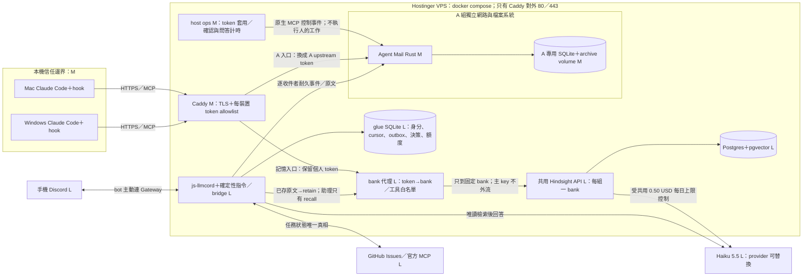

# 04 SAD — don't be a meat proxy

- 版本：0.3｜日期／查詢日期：2026-11-16｜作者：codex-senior-swe（T7）｜審查：PM-Emily → 維護者（G2）。
- 狀態：**設計草稿，足供拆票；不是部署／實測完成**。本次沒有 VPS 登入權限，沒有嘗試連線。
- 依據：G1 已確認 [Brief](01-brief.md)、[G1 結果](gates/G1-decision.md)、[PRD](02-prd.md)、[SRS v0.1（尤其 §4.2／4.4）](03-srs.md)、[DAG](00-DAG.md)、[流程缺口 GAP-01～22](diagrams/README.md)，及 research/F-01、F-01b、F-02～F-06、[F-07](research/F-07-llm-provider.md)、[F-08](research/F-08-hostinger-vscode.md)；方法沿用指導者 E 提示、SAD／SDS 模板、`to-architecture` skill。FR／NFR 追溯與逐 GAP 回應見 SDS。
- 優先序：**維護者 的 SRS §4.4 與本次定案優先於舊文件的未決文字**；Hostinger 2 vCPU／8 GB／100 GB，MVP 11-23／上線 11-30。**已定**：Hostinger DNS 的 `hub.example.invalid`、每裝置一 token、Discord `/status` ephemeral、auto mode 在 11-30、M 現況讀最近 N 交接而 L 改讀 Hindsight、助理與 retain 都用 Claude Haiku 5.5／共用每日 0.50 USD。這些不再等待選型決策；設計／部署仍須 G2／G3 與實測。F-03 的新購 VPS／容量保證不沿用。

## 情境與品質驅動

MVP 讓 維護者 在 Mac／Windows 的 Claude Code 互留原文交接、在線時互傳問題；上線批再提供手機入口、專案記憶、GitHub 任務與組員接入。Orca 只負責 維護者 本機協調，**不是跨裝置 Hub**；組員不必安裝。

| 批次 | 元件／行為 | 放行證據 |
|---|---|---|
| **M｜MVP 2026-11-23** | Caddy、A 組 Agent Mail、Mac／Windows Claude Code 設定＋收件／checkpoint hook、token／生命週期排程膠水、每日備份 | 真實兩機跨網路雙向傳訊；離線 ≥10 分鐘後新 session 第一回覆列交接 ID／摘要；重啟原文仍在；單裝置撤銷；idle ≤60 秒；24 h 未回答／30 min 確認逾時／session 結束失效留正式紀錄 |
| **L｜上線 2026-11-30** | Hindsight、Postgres/pgvector、bank 代理、記憶／通知 bridge、js-llmcord bot、GitHub Issues、`/connect`、決策／auto mode 膠水 | 記憶可回查原文；手機查詢附 ID／時間；非成員拒絕；唯讀助理不能寫入；上限生效；決策與限時授權留稽核 |
| **S3｜另過 Gate** | B～E 各自 Mail 容器／volume／網路與 bank | 跨入口、跨 bank、惡意附件路徑負面測試及實機容量通過；本次只預留，不代表 11-30 開放五組 |

主要品質落點：原文持久化／離線不代跑（US-02～04）；收件延遲（G-03／A-4）；收件人同意、預設拒絕（US-06～07）；裝置 token 撤銷（R-4／維護者 定案）；組間隔離（US-14）；外部 LLM 共用每日 0.50 USD 上限、故障不丟原文（US-08）。單 VPS 會有維護中斷，沒有 HA 承諾。

## 元件與資料流

MVP 的 docker compose 常駐僅 `caddy`、`mail-a`；本機 hook 不放 VPS。Host 的 `ops/lifecycle` 是不含 LLM 的受管計時／outbox 膠水，不是第三個 Hub／agent：兩端都關閉仍可判逾時並寄 Mail 結果，詳 SDS API-06；資源含在 OS／維運預留。上線加 `bank-proxy`、`hindsight`、`db`、`bot`（內含 bridge），以 `live` profile 控制。每個 Mail 服務只加入自己的 `mail-a-net`；Caddy／可信 bot 各自加入所需組網，Mail 不加入共享資料庫網。`bank-proxy` 才能到 Hindsight；Hindsight 才能到 db；對外 LLM／Discord／GitHub 走服務自己的 outbound 網路。backend **不發布 host port**，Caddy admin 不發布，bot 不需 inbound port。

原文先由 Mail 成功保存，再由 bridge 非同步加入記憶及通知 outbox；失敗顯示「記憶待補」或「通知失敗已記錄」，不能把已存訊息說成沒存。Discord 補發政策未決前不自動補發（SR-NTF-04）。接收程式先耐久暫存事件，agent 真正取得原文後才標已讀；已讀不代表同意／執行完成。任務建立先拿 GitHub Issue URL，之後傳 Mail；GitHub 失敗不製造本地「成功任務」。確認／決策先由 ops／glue 交易串行決定，再把結果寫 Mail 原串，保存成功後才發布生效；Hindsight 舊萃取不能覆蓋正式結果。

| 元件／批次 | 責任／擁有資料 | 失敗回饋與邊界 |
|---|---|---|
| Caddy／M | HTTPS、全站 bearer 驗證、按組路由、裝置 token 撤銷 | 無／錯／撤銷 token 回 401；reload 失敗不可回「撤銷成功」 |
| Mail-a／M；其他組 S3 | 現成 agent／MCP／訊息／已讀；SQLite 與 Git archive 保留原文 | HTTP 200 仍須檢查 MCP `isError`；斷線顯示未確認保存；重試用同一冪等鍵 |
| 本機 hook／M | 開工 context、輪詢喚醒、交接 checkpoint、本機動手確認 | 網路錯誤明示；原文在本機待送，不冒充 Hub 已保存；不改工具權限模式 |
| host ops／M | token 設定套用；Mail 控制事件重建 timer，確認結果／24 h 未回答送回原串 | SQLite 只存排程狀態與 outbox，正式結果寫 Mail；失敗不授權執行，不代答或操作別人電腦 |
| bank-proxy／L | 個人 token→固定 bank、只開允許工具；可信 ingest 寫來源作者 | 其他 bank／REST／管理路徑回 403；後端主 key 不給 client |
| Hindsight＋db／L | 衍生語意搜尋，一組一 bank；本地 embedding／reranker，雲端 LLM | 禁 delete／clear／update-bank；召回必附原文來源；不可作唯一原文庫 |
| bot＋bridge／L | Discord 成員檢查、ephemeral 指令、通知／retain outbox、決策、額度 | 重啟後 cursor／待確認資料仍在；LLM 不是核准者；不遙控別人電腦 |
| GitHub／L | Issues 任務與程式碼／PR 連結 | Issue 已建而通知失敗時只重試通知，不重建 Issue |

## 信任與資料隔離

1. **跨組**：沿用 F-01b 補洞；每組一 Mail 容器、一個專用 volume、一把 upstream token、一個內部網路。S1 入口固定 `hub.example.invalid`；S3 依已驗證 token→group 的服務端映射選後端，不能由 client 任選 group／upstream，另過路由隔離 Gate。非 root、drop capabilities、不掛其他組／host home／Docker socket；group-a 的 `/data` 看不到 group-b。惡意 `ensure_project`＋附件讀檔案例必須在 Linux 重跑。只換 port／目錄不構成隔離。
2. **組內（GAP-13）**：Mail 是互信工作區；Caddy 換成共用 upstream bearer 後，Mail **不能證明 Discord 人→唯一 agent**。M 的 token registry 綁裝置及其允許 agent 集合；同裝置不同工具共用該裝置 token，但各 agent 的 registration token 分開。這只是設定對照；保留 `MESSAGING_SESSION_IDENTITY`、fail-closed sender profile／sender token，不聲稱等於人類認證。**S2 開放 Gate**：加薄的 Mail ingress identity adapter（可與 L bank-proxy 共程序），由入口 token 查 principal／允許 agent，拒絕冒名 register／sender／owner 操作，過濾可繞過的 UI 寫路徑；測 A token 不能作 B 的 register、send 或開 grant。原生 proof-gate 是否可取代部分 adapter 要先測，未有證據不放行跨人 auto mode；不重寫 Mail 或引進完整角色系統。
3. **記憶**：bank 由 token registry 決定，忽略／剝除 `X-Bank-Id` 等可偽造路由資訊；拒絕多 bank MCP、REST、管理工具。一般 client 與助理只有讀取白名單；只有 bridge 的服務憑證可 retain，作者／session／Mail ID 從來源與 registry 填入，不採 LLM 自報值。
4. **不可信內容**：Mail 原文、Discord 輸入、LLM 回覆皆為資料。只問資訊可自動答；含寫檔／指令／接任務／合併或難分類時，收件端當 action。收件人本機確認後才動手；專案 auto mode 限來源與 1 h／最多 4 h，**不等於 Claude 的全域 auto／bypassPermissions 模式**。收件者未在線不代跑。
5. **助理**：只給本組 recall／原文讀取／GitHub 讀取工具；不用它建立 Issue、retain、確認決策或發 token。關掉 js-llmcord 自帶 RAG／forget 工具及任意 local MCP，替換預設 prompt；LLM 輸出附來源 ID／時間，無依據就說沒有資料。

## 資源與部署預算

以下是**規劃上限／預留，不是測得 peak**。以較保守的 8,000,000,000 bytes ≈ **7,629 MiB** 為總量；Hostinger 實際可用 RAM、既有服務、OS／CPU 架構／Docker 版本皆待 operator 盤點。不得搬掉既有服務騰空間。

| 項目 | 批次 | 一組 MiB | 五組 MiB（S3 試算） | 依據 |
|---|---|---:|---:|---|
| OS、Docker、管理 | M | 768 | 768 | 維運預留，含既有程序需重估 |
| Caddy | M | 128 | 128 | F-01b sampled RSS 約 46 MiB，上調 |
| Mail，每組 `mem_limit: 512m` | M／S3 | 512 | 2,560 | F-01b sampled 約 250～370 MiB，非長期 peak |
| Hindsight API＋本地 embedding／reranker | L | 2,048 | 2,048 | F-05 macOS API peak 約 1,527 MB；Linux 待驗 |
| 獨立 Postgres/pgvector | L | 512 | 512 | 工程預算；不重複算 F-05 內嵌 pg0 |
| bank-proxy | L | 128 | 128 | 膠水預算 |
| bot＋bridge＋glue SQLite | L | 384 | 384 | 含 MCP client、通知與額度，不只聊天 bot |
| 備份／尖峰／page cache 額外預留 | M／L | 512 | 512 | 排程錯峰，不在這裡編譯 Rust／跑本機生成 LLM |
| **合計** | — | **4,992** | **7,040** | **剩餘 2,637／589 MiB**；五組餘裕很小 |

MVP 只有前 3 列＋512 預留＝**1,920 MiB**。每服務用 Compose `mem_limit`，以 `docker stats`／OOM 次數／輪詢延遲量測校正；OOM 不代表可安全自動丟資料。2 vCPU：retain/consolidation 先限制單一工作並行、與備份錯峰，收件優先；五組 RAM 試算可容納不等於 CPU／延遲通過。禁止在 VPS 跑 F-05 的 4.7 GB Ollama，也不在上面做 F-01b Rust release build。[Compose 資源限制](https://docs.docker.com/reference/compose-file/services/#mem_limit)（查詢 2026-11-16）。

100 GB 磁碟先預留：OS／既有服務 20 GB、images／模型 15 GB、Mail＋glue＋PG 20 GB、輪替 logs 5 GB、備份 staging 10 GB、空間餘裕 30 GB。這是可調預算；容量不足不自動刪原文，到期清除依下方 維護者 保留政策。使用超過 70% 告警、85% 暫停新記憶工作並找 operator，不能未保存卻報成功。

### 已定網域與 HTTPS

- 依 F-08：operator 先盤點既有 VPS 的 Ubuntu／Docker／Compose；Hostinger 有 Ubuntu＋Docker 範本，**不因此重灌既有主機**。hPanel／OS 防火牆先保留實際 SSH port（預設 TCP 22，沿用既有來源限制），再允許 TCP 80／443；不對外發布 8765／8888／9999／5432／admin。啟用 default-deny 前確認 SSH 規則，並從外網驗證 Docker publish 結果，不只相信 UFW 設定。[Hostinger firewall](https://www.hostinger.com/support/8172641-how-to-use-a-managed-vps-firewall-at-hostinger/)（查詢 2026-11-16）。
- **維護者 已定：網域 `example.invalid`、DNS 託管 Hostinger**。在 Hostinger DNS 新增 `hub` 的 A 記錄指向 VPS 公網 IPv4（實值由 operator 提供）；只有確認 IPv6 可達才加 AAAA。MCP 地址固定 `https://hub.example.invalid/mcp/`，L 記憶地址 `https://hub.example.invalid/memory/mcp/group-a/`；同一 hostname 由 Caddy 路徑分流，不另要求 mail／memory 子網域。
- Caddy 持久 `/data`／`/config`，以 **Let's Encrypt＋HTTP-01** 自動簽發／續期，對外開 TCP 80／443；HTTP-01 的 ACME 路徑由 Caddy 處理，其餘業務 HTTPS 路徑仍須 token。先在隔離驗證環境測 ACME staging，再正式簽發與驗證兩端 TLS；本次沒有改 DNS 或申請憑證。移除無網域的備案規劃，網域選擇不再未決。[Caddy HTTPS](https://caddyserver.com/docs/automatic-https)、[ACME issuer](https://caddyserver.com/docs/caddyfile/directives/tls#acme)（查詢 2026-11-16）。
- 不使用 `curl -k` 或 client 跳過憑證驗證；若公共 CA 不通，回 PM 選路。Caddy 本地 CA 需每端明確信任，僅可當核准後的測試備案，不當透明替代。

## 重要決策與取捨

- **沿用 G1，不另發明通訊／記憶核心**：Mail Rust＋一組一容器、Hindsight＋bank 代理、Caddy、js-llmcord。F-01 的自寫建議已由 F-01b 與 G1 更新；授權 rider 風險由 維護者 已接受，此文件不重開決策。
- **原文與搜尋分工**：Mail 存交接原文；glue 存確認／授權等結構狀態；Hindsight 存可重建的索引記憶。代價是非同步同步與短暫索引落後，回覆必標最新資料時間。理由：F-05 retain 曾漏事實／轉簡體。
- **薄本機 hook**：不以反覆啟動 `claude -p`、鍵盤輸入注入或遠端 shell 當收件。採現成 hooks＋輪詢＋`asyncRewake` 的設計接縫；Mac／Windows 證據未齊前 A-4 不算成立，詳 SDS。替代 channels 處 research preview，不列為 MVP 必要依賴。[官方 hooks](https://code.claude.com/docs/en/hooks)、[channels](https://code.claude.com/docs/en/channels)（查詢 2026-11-16）。
- **LLM 已定、設定仍可換**：專案助理與 Hindsight retain 都用 **Anthropic Claude Haiku 5.5（`claude-haiku-5-5`）**；兩槽共用**每日總上限 0.50 USD**，不是各 0.50。`assistant`／`memory` 各保留 provider／model／base URL／key reference／輸出上限／價格表設定，日界採 Asia/Taipei；含 extraction／consolidation 等背景呼叫一併計費預留。模型 ID 已核對 [Anthropic 官方](https://platform.claude.com/docs/en/models/overview)（查詢 2026-11-16）；[F-07](research/F-07-llm-provider.md) 的推薦已由 維護者 選定，繁中萃取品質／成本仍須實測。Gemini API／gpt-oss API 僅保留可配置的替換能力，不自動 fallback，不重開 D-4。

## 運作、風險與未決

| 操作／批次 | 最小要求 |
|---|---|
| 啟動／M | operator 先盤點 VPS／F-08 防火牆前置；鎖 image digest、驗 Caddy 設定、建立 volume 權限／secrets，再啟服務與 ops 計時膠水、健康檢查、以真 MCP initialize＋send／read 驗證；只 health 200 不足 |
| 備份／M；PG 加入 L | **維護者 已定每日備份，滾動留 7 天**；另在變更前備份。暫停寫入／ops 派送，正常停 Mail，備份 SQLite＋完整 archive／Git、ops DB、token registry／Caddy 憑證設定；L 另停 ingest、備份 glue DB、`pg_dump`。manifest 記版本與 cursor／時間；加密副本離開 VPS，備份完成／驗證後才淘汰超過 7 天副本。目的地、排程時刻與 RPO-RTO 數值仍待確認；同機 copy 不算災備 |
| 每週快照／M | **維護者 已定每週一次 Hostinger 快照**。Hostinger 僅保留 1 份，新建覆蓋舊份；官方現行文件列 1 天到期，故不是每週 7 個還原點或每日備份替代。排程／operator 收據記快照 ID 與到期時間；不要把預設 weekly backup 誤當 snapshot。還原會覆蓋整機，只供 operator 在核准範圍使用。[Hostinger 官方](https://www.hostinger.com/support/1583232-how-to-back-up-or-restore-a-vps-at-hostinger/)（查詢 2026-11-16；舊支援頁顯示 20 天，採較新頁，實際 hPanel 再驗） |
| 到期刪除／M／L | **維護者 已定資料保存至 2027-03-31 後刪除**：以 Asia/Taipei 日期，刪除票於 2027-04-01 起停止該專案寫入並清除 Mail DB／archive 完整 Git 歷史、ops／glue、Hindsight bank、專案備份與本機待送副本；不是只刪目前 Markdown。到期不因每日備份留 7 天再延長。operator 用 manifest 核對衍生／備份副本，禁止自動重送／還原復活；共享整機快照與組員離線本機副本的刪除責任需於 S2 告知並安排，不宣稱可遠端抹除別人裝置。此為未來操作設計，本次不刪任何資料 |
| 還原／M／L | 先還原到隔離 compose、相同版本，驗原文 ID／雜湊、決策狀態與 cursor，再切入口；還原會帶回舊 token，重新套用最新撤銷紀錄後才開外網；不把測試還原通知發到真人 Discord |
| 日誌／M／L | JSON stdout＋Docker 輪替；含 request ID、group、工具名、status／isError、耗時、outbox lag、OOM／額度。遮蔽 Authorization／key／完整 body；稽核另持久保存，記 token ID、actor、確認／撤銷時間，不能只靠 Discord 訊息 |
| 撤銷／M；Discord 入口 L | 先停發設定，產新 allowlist，validate→原子替換→reload→用舊 token 的既有 MCP session 驗下一請求 401、其他人仍可用；L 同步 bank registry。失敗狀態為「待撤銷／失敗」，不可先報成功；已入 backend 的請求／舊 SSE 不承諾中斷 |
| 更新／回退 | 先備份、記 digest；一元件一次更新。DB migration 只允許還原成套備份回退，不以舊 image 直接讀新 schema；Mail 與 Caddy 可獨立回退，保留當前 denylist |

| 待對齊／確認 | 負責／時點 | 影響 |
|---|---|---|
| T5／T6 更新收斂、T8 測試 | PM／各 worker，G2 前 | SDS 已對應 FR-01～30、NFR-01～10、GAP-01～22；未驗證項仍不是通過 |
| A-4 idle 喚醒、長工具／權限提示時 ≤60 秒；A-5 正常／強退 hook | 實作票，MVP 前 | 不成立時 Brief 已列「下次對話收到／每段交接」降級，須由 PM 記錄驗收結果，不暗改目標 |
| 最近 N 的數值、備份目的地與到期刪除告知 | PM→維護者，MVP／S2 前 | 讀取策略、保存期限／每日留 7 天／每週快照已定；只剩數值、位置及責任，工程測試 N=3 不當產品定案 |
| Haiku API 憑證／兩槽 adapter、實際品質／usage 與全域 0.50 USD cap | operator／實作票，上線前 | provider／model／cap 已定，剩 API key 安全佈署、版本相容與硬上限驗證；不向 維護者 重問 D-4 |
| Hostinger hub A 記錄實值／TLS 驗證 | 有權限的 operator，MVP 前 | 網域／DNS 託管已定；實際 VPS IP、DNS 生效與 ACME 證據待操作，不是網域選擇未決 |
| F-08 擴充的實際連線／hook、AGY 產品身分 | 實作票／維護者，S2 前 | Claude／Codex 共用 CLI 設定已納入；共享設定不等於擴充的喚醒驗收通過 |
| Mail 人身分綁定、內容／附件／秘密驗證、撤回 | T5／PM，G2／S2 前 | client 可做欄位檢查，但原生 bytes 上限不是 20,000 字元或不可繞過的 Hub 驗證，見 SDS 的已知缺口 |
| Linux image／資源／Docker 隔離／HTTPS／還原實證 | 有權限的 operator，MVP／上線前 | 本機 F-01b／F-05 數字不能冒充 VPS 驗收 |

## 抄誰與自己寫什麼

| 元件／批次 | 固定來源／版本 | 自己只補 |
|---|---|---|
| Mail／M | [mcp_agent_mail_rust 0.3.40，a58b6d77cd16fa4e235359ae91f1b28779780d05](https://github.com/Dicklesworthstone/mcp_agent_mail_rust/tree/a58b6d77cd16fa4e235359ae91f1b28779780d05)，F-01b portable build | Compose／容器隔離與配置；Linux artifact／digest 仍待驗，release 不自動等於此 portable binary |
| Caddy／M | [v2.11.9](https://github.com/caddyserver/caddy/releases/tag/v2.11.9)，F-01b 已測 allowlist／reload | 生成／驗證 allowlist、撤銷腳本；不自寫 auth server |
| Claude Code／M | 本機 `claude --version`＝**2.1.325**；[官方 hooks](https://code.claude.com/docs/en/hooks) | `client/hub-hook.mjs`＋MCP 呼叫／本機 checkpoint；Windows 同版本能力待驗，不安裝或改全域設定 |
| Hindsight／L | F-05 API **1.2.1**；文件來源 [5318be8ea572aa00ceae636c71c1d8d334f805b6](https://github.com/vectorize-io/hindsight/tree/5318be8ea572aa00ceae636c71c1d8d334f805b6) | bank 代理、allowlist、ingest adapter；pip 版本與此 commit 的 Docker image 對應／digest 待確認 |
| Postgres/pgvector／L | 抄 Hindsight 固定 SHA 的 [external-pg compose](https://github.com/vectorize-io/hindsight/blob/5318be8ea572aa00ceae636c71c1d8d334f805b6/docker/docker-compose/external-pg/docker-compose.yaml)：`pgvector/pgvector:pg18`；[pgvector](https://github.com/pgvector/pgvector) | 鎖 PG18 patch／extension／image digest、初始化與備份；不抄 upstream 開放 8888／9999 的 ports |
| Discord bot／L | [js-llmcord c5615eb3705aaf5ca369b5c817653834b9c8ac4c](https://github.com/stanley2058/js-llmcord/tree/c5615eb3705aaf5ca369b5c817653834b9c8ac4c)（MIT） | `/connect`／撤銷、成員表、bridge outbox、唯讀工具、每日額度、決策按鈕、Issue 指令；RAG 關閉 |
| UI 行為／L | F-06 disclaw／OpenClaw：只參考已記錄的核准／拒絕／allowedUsers／TTL 行為 | 不搬整套遙控器；若實際複製程式須先鎖 commit／保留 MIT，當前無複製版本可聲稱 |
| 任務／L | [官方 GitHub MCP](https://github.com/github/github-mcp-server)，託管服務不自架；版本由服務商管理 | deterministic Issue 指令＋Discord actor／interaction ID 對照；不另做任務系統 |

新增膠水清單：`ops/render-caddy`／`revoke`／`lifecycle`／`backup-restore`／到期 purge（M；L token 由 host 的窄 `TokenApplier` 處理 bot 請求，bot 不拿 Docker socket）、`client/hub-hook.mjs`、`client/mail-client.mjs`、`server/bank-proxy`／S2 Mail ingress identity adapter、bot 的 `connect`／`bridge`／`decisions`／`issues`／`budget` adapter。這些是**待開票路徑，不是本次已實作檔案**；不重寫 MCP server、mailbox、向量庫或聊天引擎。表中補查網路來源均查詢於 2026-11-16；F-01～06 的既有證據與限制仍有效。
