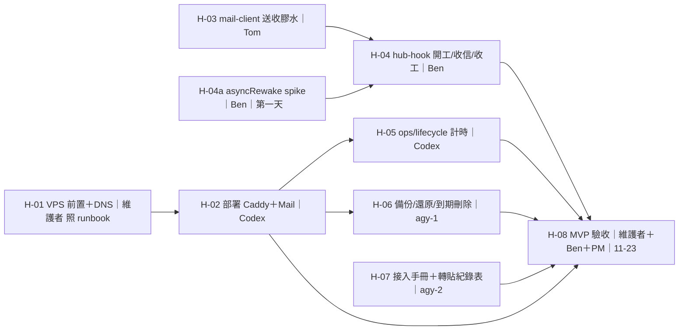

# 07 工作票 — MVP（11-19～11-23）

- 負責：PM-Emily｜審查：維護者（G2+G3）｜日期：2026-11-16｜狀態：**已核准（G2+G3，2026-11-17）**
- 上游：`docs/04-sad.md`、`docs/05-sds.md`（v0.3）、`docs/06-test-plan.md`、`docs/03-srs.md`
- 規則：一票一對話、TDD（專案流程 H，`skills/tdd`、`skills/implement`）；程式只寫 SDS 列出的膠水，其餘照 SDS 抄。每票完成要附測試輸出，不能只說「通過」。
- 程式放本 repo：`deploy/`（compose、Caddyfile 範本）、`ops/`（VPS 上的腳本）、`client/`（Mac／Windows 的 Node 膠水）、`.claude/`（hook 範本）。秘密一律不進 git。
- 上線批次（11-24～11-30：Hindsight、bank 代理、Discord bot、GitHub、auto mode）的票在 MVP 驗收後另開。

## 依賴圖

## 票

| 票 | 內容 | 負責 | 依賴 | 完成條件（測試） | 期限 |
|---|---|---|---|---|---|
| **H-01** | VPS 前置：Codex 先寫 runbook（盤點既有服務、Hostinger 防火牆開 22/80/443、Docker 版本、`hub.example.invalid` A 記錄），維護者 照做或授權代做 | Codex 寫／維護者 執行 | — | `dig hub.example.invalid` 指到 VPS；盤點結果寫入 `docs/ops/vps-inventory.md` | 11-19 |
| **H-02** | `deploy/` compose：Caddy v2.11.9＋`mail-a`（鎖 image digest、`mem_limit`、不發布 backend port）；`ops/render-caddy`、`ops/revoke`；Mac、Windows 各一把裝置 token；bootstrap BlueLake／RedStone／HubClock | Codex | H-01 | TC-01（無／錯 token 401）、TC-05（重啟持久）、TC-10（單裝置撤銷）、TC-11、真 MCP initialize＋send／read（只看 health 200 不算） | 11-20 |
| **H-03** | `client/mail-client.mjs`：發送 adapter（envelope v1、`topic`、20,000 code points 上限、idempotency key、401／429／503／逾時對應、「結果未確認」）、耐久收件（`fetch_inbox_events` cursor、`mark_read=false`、原文 staging） | Tom | —（先對本機 Mail 容器測） | 單元測試（FakeClock、注入錯誤）；TC-03（原文逐字取回）、TC-11 | 11-20 |
| **H-04a** | spike：Mac 上 Claude Code 2.1.325 的 `asyncRewake` hook 能否在 idle 時喚醒 session（用假事件，不接 Hub）；同時確認 Windows 版本可行性 | Ben | — | 實測紀錄：idle／回答中／長工具三種情況的喚醒耗時；不行就照 Brief A-4 降級並回報 PM | 11-19 |
| **H-04** | `client/hub-hook.mjs` 的 `start`／`watch`／`stop`／`end`＋`.claude/settings.json`＋`hub-client.json` 範本；開工顯示未讀與最近 N 則交接；checkpoint 交接；session 結束上報 | Ben | H-03、H-04a | TC-02（G-02）、TC-04、TC-06、TC-13（每方向 n≥5，round-trip ≤60 秒）；強退後下次開工提示 | 11-22 |
| **H-05** | `ops/lifecycle`（HubClock）：question 24 h 未回答、action `presented` 後 30 分鐘逾時、session.closed 改失效；單 writer lock、outbox、固定 idempotency key | Codex | H-02 | FakeClock 單元測試；TC-07、TC-08、TC-09、TC-12 | 11-22 |
| **H-06** | `ops/backup-restore`、到期刪除（2027-03-31）：每日備份留 7 天、還原演練、每週加密副本拉回 維護者 的 Mac | agy-1 | H-02 | 實際還原到乾淨 volume 後原文與 cursor 一致的紀錄 | 11-22 |
| **H-07** | `docs/onboarding-S1.md`：Mac（zsh）與 Windows（PowerShell）接入步驟、token 放哪、怎麼確認 `/mcp`、常見錯誤；`docs/metrics/G-01-paste-log.md` 紀錄表 | agy-2 | H-02 設定定稿 | 維護者 照手冊在 Windows 上 ≤15 分鐘接上（S1 不要求 5 分鐘） | 11-21 |
| **H-08** | MVP 驗收：維護者 在 Mac＋Windows 照 `06-test-plan.md` 跑 TC-01～13，Ben 陪跑記錄，PM 寫 `docs/delivery-MVP.md` | 維護者＋Ben＋PM | 全部 | 每個 TC 附實際輸出；未過的列出與處理方式 | 11-23 |

## PM 已定的工程取捨（不改產品承諾）

- 20,000 字元與密鑰偵測：MVP 只在 client adapter 檢查（S1 只有 維護者 自己，互信）；**伺服器端 validator 放上線批次，S2 開放組員前必須完成**。
- 最近 N 則交接：N＝5（維護者，G2+G3）。
- 撤回、Discord 同意 action、通知補發、建 Issue 二次確認、決策草稿期限：MVP 不做，上線批次前再問。
