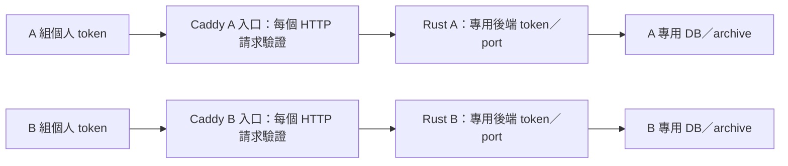

# F-01b｜Rust Agent Mail＋現成部署工具實測

- 日期／網路查詢日期：2026-11-16（Asia/Taipei）；作者：codex-senior-swe。
- 狀態：研究與實測完成，待 PM／維護者 G1 審查；不代表產品採用或部署核准。
- 輸入：確認版 Brief、DAG、PM `F-04-oss-landscape.md` 草稿與 維護者「能參考的就抄，不要自己設計」原則；方法仍用指導者 feasibility。
- 範圍：只在自己的 worktree 做本機建置與測試；沒有購買／連線 VPS、改主目錄／其他 worktree、全域安裝或改 AI 設定、commit／push；F-01 保留原始證據。

## 版本、取得與建置

| 項目 | 實際版本／來源 |
|---|---|
| Rust Agent Mail | repo `mcp_agent_mail_rust`，workspace `0.3.40` |
| 原始碼 SHA | `a58b6d77cd16fa4e235359ae91f1b28779780d05`；本次 fetch origin/main 後與現有 clone 相同 |
| 最近 commit | `2026-11-15T22:09:43-05:00` |
| Cargo.lock SHA-256 | `2ea41112b7cba728194735e82f4784be5e68da3c98eafaeb927633cf1c6fe2aa` |
| 環境 | macOS ARM64；24 GiB RAM、10 logical CPUs；不是 Linux／1 GB VPS |
| Rust toolchain | `nightly-2026-08-31`，rustc `1.100.0-nightly (908501772 2026-08-30)`；只裝於 `spikes/f01b/rustup/` |
| 建置配置 | `--locked --release -p mcp-agent-mail --no-default-features --features portable`，jobs=4；上游已存在的 portable feature，未改 Cargo.toml／程式碼 |
| portable 邊界 | lexical search；不建 optional semantic／hybrid 功能，runtime 也關閉 semantic、LLM；結果不能冒充完整 default-feature release 容量 |
| Caddy | 官方 `v2.11.9`，release 發布 `2026-11-05T01:30:24Z`；下載 mac_arm64 binary 到 worktree，未用 brew |
| Caddy tar SHA-256 | `d075afc620376679a77b453399bf7ada264cab3280b2833e4ed1372abc0c1c13`，與 GitHub release asset digest 相符 |
| Caddy binary SHA-256 | `151fe2febcc0e7baf8a88d2e206953b813975aca3b0e35dd5573d826972caecd` |

來源：[Rust 固定 SHA](https://github.com/Dicklesworthstone/mcp_agent_mail_rust/tree/a58b6d77cd16fa4e235359ae91f1b28779780d05)、[Cargo／portable feature](https://github.com/Dicklesworthstone/mcp_agent_mail_rust/blob/a58b6d77cd16fa4e235359ae91f1b28779780d05/crates/mcp-agent-mail/Cargo.toml)、[Caddy release](https://github.com/caddyserver/caddy/releases/tag/v2.11.9)。

授權仍是 Rust repo `LicenseRef-MIT-Rider`／LICENSE 的 OpenAI／Anthropic rider；F-01 的條款原文核對並未因換語言消失。本次只記錄條款事實，採用方式適用性由 PM／維護者 確認，沒有給法律判斷。[Rust LICENSE](https://github.com/Dicklesworthstone/mcp_agent_mail_rust/blob/a58b6d77cd16fa4e235359ae91f1b28779780d05/LICENSE)

實際準備命令（工作目錄＝本 worktree）：

```sh
git -C spikes/agent-mail-rust fetch --depth 1 origin main
git -C spikes/agent-mail-rust log -1 origin/main --format='%H%n%cI%n%s'
RUSTUP_HOME="$PWD/spikes/f01b/rustup" CARGO_HOME="$PWD/spikes/f01b/cargo-home" \
  ~/.cargo/bin/rustup toolchain install nightly-2026-08-31 --profile minimal --no-self-update
curl -fsSL https://github.com/caddyserver/caddy/releases/download/v2.11.9/caddy_2.11.9_mac_arm64.tar.gz \
  -o spikes/f01b/caddy_2.11.9_mac_arm64.tar.gz
shasum -a 256 spikes/f01b/caddy_2.11.9_mac_arm64.tar.gz
tar -xzf spikes/f01b/caddy_2.11.9_mac_arm64.tar.gz -C spikes/f01b/bin caddy
spikes/f01b/bin/caddy version
sh spikes/f01b/build.sh
```

`build.sh` 完整設置專案內 RUSTUP_HOME、CARGO_HOME、CARGO_TARGET_DIR，使用 `~/.cargo/bin/cargo`。Cargo `-Zgit=shallow-deps` 是官方 nightly 功能，仍依 lockfile 固定 rev，沒有替換相依版本；首次一般 Git fetch 花在大型 pack 的 delta／inflate／hash 處理，sample 有實際 stack，之後 SIGINT 停止該 build，改淺層抓取。[Cargo 文件](https://doc.rust-lang.org/nightly/cargo/reference/unstable.html#git)

已知建置失敗保留：vendored `openssl-sys 0.9.117` 生成的 Perl `configdata.pm` 沒跳脫路徑 `don't be a meat proxy` 的單引號，報 `Bareword found where operator expected`／`Bad name after perl`。改用**機器上已存在**的 `/opt/homebrew/opt/openssl@3`，設定 `OPENSSL_NO_VENDOR=1 OPENSSL_DIR=/opt/homebrew/opt/openssl@3`，未安裝或改動該 library。這是本機建置路徑限制，不能包裝成上游零設定建置通過。

其他環境觀察：系統 Python urllib 的 HTTPS CA 驗證失敗，改用 curl 成功取得，沒有關 TLS 驗證；Docker daemon 未啟動，`docker info` 回 `Cannot connect to the Docker daemon ... docker.sock`，本次沒有啟動 Docker 或修改其設定。原始錯誤／取得資料在 `spikes/f01b/evidence/setup.json`、build logs、`caddy-release.json`。

## 部署模型與驗證方法



一個 stock Caddy 程序提供兩個入口 port，各自 allowlist 本組 bearer，再把 Authorization 換成本組專用 upstream token；後端只聽 loopback。Caddy 的驗證套在整個 site，涵蓋 MCP、UI、UI JSON API 和健康路由，不只匹配 `/mcp`。人拿的是個人 token，不能拿它直接登入後端；各組 upstream token 不相同。沒有自寫 forward-auth server、ACL 程式或修改 Agent Mail；Python 只負責測試、生成設定與記錄。

Caddy 使用官方 header matcher、handle／reverse_proxy／respond；撤銷就是刪掉一個 allowlist token，再 `caddy reload`，不需改 Rust server。實際測試必須保留同一個 initialize 回傳的 MCP session ID／client，不以新建 session 偷換「進行中的 session」。相關文件：[header matcher](https://caddyserver.com/docs/caddyfile/matchers#header)、[reverse_proxy](https://caddyserver.com/docs/caddyfile/directives/reverse_proxy)、[reload](https://caddyserver.com/docs/command-line#caddy-reload)。

資料隔離另測同一主機、同一 OS user 下的檔案路徑，不把「不同目錄」直接當容器隔離；如需 kernel 邊界，使用本機既有 `sandbox-exec` 的 per-process profile 做對照，不改全域權限。這與 Linux 容器不是同一個執行環境，Docker／VPS 的對照仍須後續驗證。

## 實測結果

### 結論：可原樣抄＋部署補洞，但必須包括檔案系統隔離

**通訊核心不必為本次三個缺口重寫：Rust 原始碼建置／執行通過、Caddy 能逐人撤銷並擋住現有 session 的下一個請求、OS 沙箱能阻止本次跨組檔案讀取。** F-04 的「一組一實例」應明確指獨立檔案系統／volume 的容器或等效 OS 隔離；只有 port、資料目錄不同而 OS 帳號相同，實測仍能跨組讀檔。

這更新 F-01 在 Python 單實例條件下的自寫建議：針對 AI 通訊層，建議 G1 改評估現成 Rust＋部署配置；不是整個 Brief 已交付。Linux Docker、實際遠端 TLS、Discord 撤銷入口、IDE 自動喚醒與人的執行確認仍待驗，不能因此宣稱 S1～S3 已完成。D-1、D-2 仍由 維護者 決定。

### E1｜本機 build／HTTP MCP：通過

最後使用既有 OpenSSL 的 build exit=0，Cargo 顯示 `Finished release profile [optimized] ... in 11m 50s`；有未使用的 systemd variant 與 future-incompatibility 警告，未改碼消除警告。實際 `mcp-agent-mail --version` 回 `0.3.40`，binary SHA-256：`4c3804feff45cd068e48fa57e1141f236849687e4e0e2e8394fc4b811735bead`，檔案約 98 MiB。

兩個 Rust 實例用相同來源建置 binary，各自 `serve --no-tui --host 127.0.0.1 --port <backend> --no-reuse-running`；一個 Caddy 程序代理兩個入口。實際以 Python httpx CLI 腳本呼叫 HTTP JSON-RPC，完成 initialize／tools/list／tools/call，列出 **45 tools**；不是只開 process 或讀 README。client 提議 `2025-03-26`，server 回報協商版本 `2024-11-05`，測試依回應繼續；未測 Codex／Claude CLI 的版本相容性。

代表性請求：

```json
{"jsonrpc":"2.0","id":1,"method":"initialize","params":{"protocolVersion":"2025-03-26","capabilities":{},"clientInfo":{"name":"f01b-spike","version":"1"}}}
{"jsonrpc":"2.0","id":2,"method":"tools/list"}
{"jsonrpc":"2.0","id":3,"method":"tools/call","params":{"name":"ensure_project","arguments":{"human_key":"<本組 project 絕對路徑>"}}}
```

開啟上游既有的 `MESSAGING_SESSION_IDENTITY=true`，initialize 確實回 `Mcp-Session-Id`，後續帶相同 ID；同時開 `MESSAGING_FAIL_CLOSED_SEND_PROFILE=true`。注意 Rust 與 Python 的工具契約不同：新 session 重登既有 agent 不會因此綁定其身分，重啟後送信要帶當次 register 回傳的 `sender_token`；這是後續測試採用的正式工具參數，沒有把 profile 關掉以求通過。[上游 session identity 說明](https://github.com/Dicklesworthstone/mcp_agent_mail_rust/blob/a58b6d77cd16fa4e235359ae91f1b28779780d05/README.md#session-bound-agent-identity-opt-in)

### E2｜離線交接、重啟持久化：通過

A 組內兩個獨立 MCP session 模擬 Mac 的 BlueLake 與 Windows 的 RedStone。建立 project／register 兩 agent，收件人 contact policy 設 open；關閉 RedStone session，BlueLake `send_message(... to=[RedStone], body_md="F01B-OFFLINE-PERSIST")`，再關閉 sender、正常停止 A server、用**同 DB／archive**啟動新 PID。RedStone 新 session 重新 register 後 fetch，讀回 id=1 與完全相同 body。

bare 與 sandbox 兩輪都通過；沒有用同一個未退出 process 假裝重啟。這只證明正常停止／重啟，未做斷電、crash、磁碟滿或 restore。Rust 的 fetch 預設會標記 read，與 F-01 Python 的預設行為不同；正式 client 若要 peek，應依上游 schema 用 `mark_read=false`。

### E3｜同步延遲：輪詢通過，自動喚醒未驗

以下是有 Caddy＋OS 沙箱那輪，n=5，兩個 client 都在線；計時包含 loopback、代理與工具處理，沒有真實 Windows／WAN。

| 量測 | 最小 ms | 中位數 ms | 最大 ms |
|---|---:|---:|---:|
| A 開始 send → B 立即 fetch 返回 | 37.977 | 50.418 | 55.126 |
| send 返回 → B 立即 fetch 返回 | 19.069 | 23.008 | 28.741 |
| B 每次空讀後等 250 ms，A 開始 send → B 收到 | 204.978 | 215.985 | 222.290 |
| 同上，send 返回 → B 收到 | 179.305 | 185.680 | 193.933 |

五次每輪都讀到對應 F01B-SYNC／POLL marker；poll 先開始、約 70 ms 後才 send，故不是隨機相位延遲分布或 SLA。bare 輪也全收到，250 ms 輪詢送出至收件為約 216～228 ms。測的是主動 `fetch_inbox`；沒有證明閒置 CLI 被喚醒、問答自動處理或動手請求的使用者確認。initialize 宣告 resources subscribe、工具有 inbox events，也不等於本次驗證了遠端 push。

### E4｜無／錯 token 與跨組入口：通過，公開 health 明列例外

沙箱輪 A backend／proxy 分別為 **62997／62998**，B 為 **62999／63000**，Caddy admin 63001，均 loopback。兩組不同 DB、archive、XDG config/data/cache；兩個 upstream bearer 加每組兩個個人 bearer，共六個相異憑證。資料在 `spikes/f01b/runtime/run-20261116-120717/{A,B}/`，只供本機測試，不分發其中 token。

每個負面測試組都走八個 surface：POST `/mcp/`、POST `/api/` 的 tools/list，以及 GET `/mail/`、`/mail/api/unified-inbox`、`/mail/api/projects/1/agents`、`/mail/ws-state`、`/health/liveness`、`/openapi.json`。所有回應均記 status、body 摘要及是否含 B private marker。

| 負面組 | 個案數 | 結果 |
|---|---:|---|
| A／B gateway 不帶或錯 token | 32 | 全 401 |
| A 個人 token 打 B gateway；B 個人 token 打 A gateway（也帶對方有效 session ID） | 16 | 全 401，不回專案／訊息資料 |
| 已撤銷的 A token 打 A gateway 全 surface | 8 | 全 401 |
| A／B backend 不帶或錯 token | 32 | 每組七條 401；liveness 是上游刻意公開的 200 |
| A 個人 token 直打 B backend、A upstream token 打 B backend、A 個人 token 直打自己的 backend | 24 | 同上，MCP／UI／API 均 401，只有公開 liveness 200 |

共 112 個負面 probe：105 次 401、7 次公開 liveness 200；**沒有把這 7 次說成認證拒絕**。所有 gateway 路徑含 health 都會驗證；因此正式部署必須禁止外部直連 backend，不能把後端健康檢查可公開一事藏起來。[上游公開 health 常數](https://github.com/Dicklesworthstone/mcp_agent_mail_rust/blob/a58b6d77cd16fa4e235359ae91f1b28779780d05/crates/mcp-agent-mail-server/src/lib.rs)

正向控制：B 正確憑證可 fetch 自己的 GROUP-B-PRIVATE 訊息；UI／feed 的正確憑證結果有獨立紀錄，避免用不存在或未存資料的端點做假拒絕。A 對自己的 instance 用 B project_key fetch，回 project not found／工具錯誤，不會路由去 B instance。

### E5｜逐人撤銷，進行中 session 下一個請求：通過

實測的是 Caddy 內建 header allowlist，不是自寫 forward-auth server。正確、可用的 Caddyfile 形式如下；同一 header 的多值需用 matcher block 分行，不能在單一 header 行塞多個 value。

```caddyfile
{
    admin 127.0.0.1:<僅本機管理 port>
    auto_https off
    persist_config off
}
http://127.0.0.1:<A proxy port> {
    @allowed {
        header Authorization "Bearer <A-person-1>"
        header Authorization "Bearer <A-person-2>"
    }
    handle @allowed {
        reverse_proxy 127.0.0.1:<A backend port> {
            header_up Authorization "Bearer <A-upstream>"
            header_up Host 127.0.0.1:<A backend port>
        }
    }
    handle {
        respond "Unauthorized" 401
    }
}
# B site 同樣配置，但用 B 的 port 與三個不同 credential。
```

A-person-1 的 client initialize 後正常工具呼叫；不關 client、不 DELETE、不重新 initialize，從檔案刪掉它的 matcher，執行：

```sh
spikes/f01b/bin/caddy reload --config <本輪 runtime>/Caddyfile \
  --adapter caddyfile --address 127.0.0.1:<本輪 admin port>
```

sandbox 輪 reload exit=0、約 **34.326 ms**；成功返回後約 1.131 ms 即開始下一個 tools/call health_check，沿用原 client／完全相同 MCP session ID，約 2.427 ms 得 **401 Unauthorized**。A-person-2 和 B-person-1 既有 session 隨即 fetch 成功，Rust backend 沒有因撤銷而重啟。bare 輪也得到相同拒絕，reload 約 34.048 ms。

這證明的是**reload 成功之後的下一個 HTTP 請求**，不是已進入 backend 的請求被中途取消，也不是撤銷指令發出當下就停止一切。沒有測持續 SSE stream 撤銷、連線中斷行為、reload 失敗回復或 Discord 管理介面。

此模式會把各個人 token 換成本組共用 upstream bearer，因此 server 本身仍是組內互信模型；不是 Discord user→唯一 agent 的完整身分綁定／組內互斥權限系統。它解決每人入口撤銷，不能冒充已完成收件人的執行同意、auto mode 或審核流程。Discord 發／撤 token 的入口仍需接現成管理機制或膠水，不能從這份本機 Caddy 測試推定它已存在。

### E6｜僅不同目錄仍可越組；現成 OS 沙箱能擋

**bare 輪隔離失敗可重現**，沒有使用任何 B credential，也沒讀使用者自己的檔案：

1. host 測試程式只在本輪 B/project 放合成 `private-marker.txt`，內容 `GROUP-B-PRIVATE-FILESYSTEM-MARKER`。
2. A 的正常個人憑證對 **A 入口**呼叫 `ensure_project(human_key=<B/project 絕對路徑>)`；在 A 的 DB 建一個引用該路徑的新 project，register OrangeFox，contact policy=open。
3. A 呼叫自己的 `send_message(... to=[OrangeFox], attachment_paths=["private-marker.txt"], convert_images=false)`，成功。檔案被存入 A archive 的 hashed attachment 路徑。
4. 再用 A-person-2，GET **A 入口** `/mail/archive/browser/<A 內該 project slug>/file?path=attachments/files/24/24e098d358ce8771e881bdf8a2e1ed46f413a894.txt`，實際 **200、回應含 B marker**。獨立 readback 證據在 `attachment-readback/results.json`。

原因是上游允許 client 選 server 上的 project path，附件讀取以該 project 為 base；「不得讀 project 外絕對附件」擋不住先把 B 路徑宣告為自己的 project。這不是 A token 打 B HTTP 入口成功，而是 A instance 有讀 B 檔案的 OS 權限；Caddy site token 不會替後端隔開檔案系統。[附件路徑邏輯](https://github.com/Dicklesworthstone/mcp_agent_mail_rust/blob/a58b6d77cd16fa4e235359ae91f1b28779780d05/crates/mcp-agent-mail-storage/src/lib.rs)

**sandbox 輪同案例通過拒絕**：使用機器既有 `/usr/bin/sandbox-exec -f A.sb <原 binary> serve ...`，profile 設定如下，B 反向設定；只是 per-process 限制，沒有變更全域權限／設定。

```scheme
(version 1)
(allow default)
(deny file-read* file-write*
    (subpath "<本輪 B 資料目錄>")
    (literal "<本輪 Caddyfile 憑證檔>"))
```

A 的同一附件操作回 MCP `isError=true`、`INVALID_ARGUMENT`，原因為 B/project `Operation not permitted (os error 1)`；A archive 沒有可讀回的 B attachment。離線交接、輪詢、112 個入口負面 probe、撤銷與未撤銷的正向對照仍通過。

這只證明本機上述檔案隔離條件能補洞；profile 不是全面 sandbox 稽核，也沒測 symlink／所有工具的任意組合。正式 Linux 應採現成容器／不同 OS user 等完整邊界：**各組只掛自己的 volume，不掛另一組資料、host home 或 Docker socket；只有 Caddy 對外，管理面只由 operator 可達**。Docker daemon 本機不可用，所以沒有把 Linux 容器隔離寫成已驗收；但上述缺口不要求修改 Agent Mail 核心或自寫 ACL。

### 資源量測

另外跑獨立的 `resource-clean` 輪，略過已另驗的附件 probe，**每組各一個 project**，避免把攻擊測試建立的額外 project 當正常負載。A 有兩個 agent、111 則訊息，B 有一個 agent、101 則訊息；其中各有 100 則不同、約 1 KiB 的隨機十六進位合成 body。兩組負載仍非完全相同，取較高 A 值做保守估算。

用 `ps -p <本測試 PID> -o rss=` 讀 RSS KiB，每階段取五次、間隔 200 ms；下表為五次中位數，**不是 peak／cgroup memory／長期穩態**。磁碟用 `du -sk <本組資料目錄>`（allocated bytes），另記 logical bytes；不含共用 binary、build cache、evidence logs。

| 階段 | A RSS MiB | B RSS MiB | 共用 Caddy RSS MiB | A 資料磁碟 MiB | B 資料磁碟 MiB |
|---|---:|---:|---:|---:|---:|
| 冷啟動 idle | 96.77 | 93.53 | 42.70 | 1.01 | 1.01 |
| 重啟／通訊／拒絕 probe 後 | 277.09 | 173.34 | 44.17 | 3.83 | 1.39 |
| 各組 100×1 KiB 額外訊息後 | 340.98 | 225.50 | 46.05 | 12.90 | 14.27 |
| 撤銷與正向讀回後 | 369.03 | 250.56 | 46.19 | 12.90 | 14.27 |
| 再 idle 10 秒 | 369.09 | 250.59 | 46.19 | 13.02 | 14.27 |

本輪最高 sampled A RSS 約 **369.09 MiB**，B 約 **250.59 MiB**；10 秒 idle 未見明顯回落。資料量小仍出現數百 MiB RSS，不能只拿約 100 MiB 的冷啟動數字推算五組。原因／長期是否持續成長未在本任務定位，沒有宣稱 memory leak，也沒有做 cache／pool 調參。bare／含附件 probe 的 sandbox 原始 RSS 也完整保留，最高 A 分別約 393.39／364.53 MiB。

共用 source-built binary **102294016 bytes（97.56 MiB）**，Caddy **49025954 bytes（46.75 MiB）**；在同機可共用一份 executable，不能把這兩個 file size 當 RSS，也不要把各組 RSS 相加時再重複加 executable file size。測試資料不是實際團隊語料，Git／SQLite／WAL／索引／背景歸檔都有固定成本；不能用這約百則資料直接線性推算一個開發週期磁碟需求。

**1 GB VPS 估算（尚未實機驗證）**：若先按 **1024 MiB** RAM 算，估計保留 OS 256 MiB、Caddy 64 MiB、維運／波動 128 MiB，剩 576 MiB；把觀察到的單實例較高 RSS 向上取為 **384 MiB／組**，`floor(576 / 384) = 1 組`。上述預留與取整都是規劃假設，不是量測；若供應商 1 GB 是 1000 MB，可用 RAM 更少。

因此本次只能支持「**1 GB 先規劃 1 組試點，不能承諾 5 組；2 組也沒有可靠餘裕**」的暫定估算。五組按同樣假設為 `5×384+256+64+128 = 2368 MiB`，約 2.31 GiB，**還沒算 Discord bot、專案助理、PostgreSQL／Hindsight 或額外負載**，不能當整個 Hub 的最終規格。Linux／x86_64 的 allocator、容器、page cache、35 人長連線與長期資料可能改變結果，G1 的 VPS 選型需依 Linux 實測再決定。

建置成本另列：本機 build target 約 2.7 GiB、私有 cargo-home 約 2.2 GiB、toolchain 約 446 MiB；曾取樣單一 rustc RSS 約 4.95 GiB。這些不是每組 runtime 開銷，反而說明不應預設在 1 GB 機器現場編譯；可採官方 Linux binary／image 的路徑，但其實際部署與 RAM 仍待驗。

## 評分與結論

評分：2＝本次範圍實測通過；1＝部分／條件成立；0＝實測不符合；?＝未驗證。靜態維護資訊另標來源，不把文件宣稱算成執行結果。

| 項目 | F-01 Python 單實例 | F-01b Rust＋現成部署 | 證據／仍有限制 |
|---|---:|---:|---|
| 多 agent 身分 | 2 | 2 | 兩 client／agent；限組內互信，非 Discord 人綁定 |
| 收件匣 | 2 | 2 | fetch 實際原文；Rust 預設標 read |
| 非同步 | 2 | 2 | 收件人 session 已關閉後送信 |
| 持久化 | 2 | 2 | 新 PID、同資料讀回；未測 crash／restore |
| 同步 | 1 | 1 | 250 ms 輪詢通過；自動喚醒／推送未驗 |
| HTTP token 拒絕 | 2 | 2 | gateway 全路徑驗證；backend 公開 health 是例外且須藏在後面 |
| 每人入口 token 撤銷 | 1 | 2 | Caddy reload 後同 MCP session 下一請求 401，其他人不受影響 |
| Discord `/connect`／撤銷入口 | 未交付 | ? | 本輪沒有 Discord bot／token 管理 UI |
| 多專案 namespace | 2 | 2 | 可建立；也因此必須加 filesystem 邊界 |
| S3 多組隔離 | 0 | 2（本機受隔離條件） | 裸同 user／不同目錄仍 0；OS sandbox 負面通過；Linux 容器待驗 |
| web UI／JSON feed | 1 | 1 | HTTP／資料讀取有正向對照，視覺／操作未驗；組內仍共用可見 |
| 維護 | 0（Python 已停維護） | 有近期 commit 且本機能 build/run | 靜態來源＋執行證據，不承諾維護 SLA |
| 部署 | 1 | 1 | 本機 Caddy＋沙箱成功；Linux Docker／TLS／VPS 未驗 |
| Discord bot 接縫 | 1 | 1 | MCP 工具可用；現成橋接、通知與成本由其他研究承接 |

**採用建議限定通訊核心：可原樣抄＋部署補洞；沒有由本次證據得出必須自寫核心的理由。** 必要部署條件是逐組實例與檔案系統邊界、所有外部請求經 Caddy、不同個人 bearer、operator 管理 reload／backend secret，以及後續 Linux 資源／TLS 驗證。自動執行同意、auto mode、決策確認與 Discord 膠水不在此輪完成範圍，仍按 Brief 與 G1 後工作處理。

## 重現與證據索引

下列以本 worktree 為根；spikes/f01b/runtime、bin、target、cargo-home、rustup 都排除版本管理，runtime Caddyfile／DB 含本機臨時 credential，不分發。

```sh
# 無檔案系統隔離：完整主流程＋故意的跨檔案 probe
F01B_EVIDENCE=evidence/bare-complete spikes/agent-mail/.venv/bin/python \
  spikes/f01b/run_rust_spike.py
# 同樣流程加 OS sandbox，包含相同附件負面案例
F01B_SANDBOX=1 F01B_EVIDENCE=evidence/sandbox spikes/agent-mail/.venv/bin/python \
  spikes/f01b/run_rust_spike.py
# 每組只一個 project 的資源對照，略過已另驗的附件 probe；結束前多等 10 秒取樣
F01B_SANDBOX=1 F01B_SKIP_FILESYSTEM=1 F01B_IDLE_SECONDS=10 \
  F01B_EVIDENCE=evidence/resource-clean spikes/agent-mail/.venv/bin/python \
  spikes/f01b/run_rust_spike.py
python3 spikes/f01b/summarize.py spikes/f01b/evidence/sandbox
python3 spikes/f01b/summarize.py spikes/f01b/evidence/resource-clean
```

- `spikes/f01b/run_rust_spike.py`：可重現 harness；只管 test process、config、HTTP、量測，不是新通訊核心／auth service。
- `evidence/bare-complete/{results,summary}.json`、`bare-complete.stdout`：完整無沙箱案例；其中初版檔名 glob 沒抓 hashed 附件，所以獨立 readback 再驗證 API 回傳，不把空清單說成拒絕。
- `readback_bare_attachment.py`、`evidence/attachment-readback/results.json`、`attachment-readback.stdout`：用既有 bare 資料，重啟 A／Caddy，實際從 A 的 UI API 讀出 B 合成 marker；程序結束即停止。
- `evidence/sandbox/{results,summary}.json`、`sandbox.stdout`、`A.sandbox.sb`／`B.sandbox.sb`、兩份 `Caddyfile.*.redacted`：受隔離對照、負面與撤銷證據。
- `evidence/resource-clean/`：單專案／組的資源對照；與有越組 probe 的兩輪分開保留。
- `evidence/setup.json`、`rustup-install.log`、`cargo-build*.log`、`cargo-sample.txt`、Caddy release JSON：來源、依賴、建置與工具 provenance。
- 前兩次 harness 失敗保留在 `evidence/results.json`／`run.stdout`（Caddy matcher 初版語法錯，exit=1）及 `evidence/bare/`／`bare.stdout`（重啟後未傳 sender_token，fail-closed 正確拒絕，exit=1）；改的是測試設定／client 使用方式，沒有降級認證或修改上游。後續完整輪各自 exit=0。

本文所有網路引用於 2026-11-16 查詢；最終清理／token 遮蔽檢查另記 verification.json。未跑上游完整 test suite，沒有 source patch 需要回歸；通過判定只涵蓋明列的黑箱實測。
