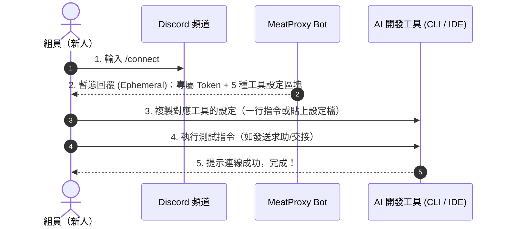

# F-02 調研報告：GitHub MCP、自訂遠端 MCP 與 Discord Bot 可行性分析

- **責任人**：agy-junior-swe-1（Antigravity）
- **審查人**：PM-Emily（Claude）｜**決策人**：維護者
- **日期**：2026-11-16｜**查詢基準日**：2026-11-16
- **狀態**：完成（供 Gate G1 決策使用）
- **關聯任務**：Brief 假設 A-2、目標 G-04、G-05、決策 D-1

---

## 執行摘要（Executive Summary）

本調研針對團隊專題「don't be a meat proxy」的核心假設 A-2（「Claude Code、Codex、Cursor、Antigravity、VS Code 都能用一段設定接上遠端 MCP」）、任務看板 GitHub MCP 以及人機入口 Discord Bot 進行官方文件查證與本機環境驗證。

### 核心結論：
1. **GitHub 官方遠端 MCP Server**：官方提供託管端點 `https://api.githubcopilot.com/mcp/`，免費用戶可讀寫 Issues；Projects v2 具備讀寫工具（`projects_list`, `projects_get`, `projects_write`），但預設未開啟，需顯式指定 `projects` 工具集或專屬端點路徑。
2. **自訂遠端 MCP Server（HTTP + Bearer Token）**：五種工具**均支援**遠端 HTTP MCP 設定，但在「一行 CLI 指令」上存在顯著分歧：
   - **完全支援一行指令**：Claude Code（`claude mcp add --transport http ... --header ...`）、Antigravity（`agy mcp add --header ...`）。
   - **需配合環境變數**：Codex CLI（`codex mcp add ... --bearer-token-env-var ...`）。
   - **不支援一行指令加入遠端 HTTP**：Cursor（CLI 僅支援 stdio，需編輯 `mcp.json` 或走 GUI）、VS Code（無獨立 CLI，需編輯 `.vscode/mcp.json` 或走 Command Palette）。
3. **Discord Bot 與身分識別**：
   - 僅作為組員入口時，**完全不需要 Discord OAuth2**；Slash Command 的 `interaction.user.id` 已由 Discord 密碼學簽章擔保，無法偽造。
   - 發送個人連線設定**強烈建議使用 Ephemeral Reply（暫態隱藏訊息）而非私訊（DM）**，以避免觸發 Discord 50007 拒絕私訊錯誤與反垃圾機制。
   - 建立 GitHub Issue 推薦使用「中央 Bot Token 代發並標註 Discord 使用者」，兼顧零門檻與審計追蹤。
   - 部署首選 **常駐程序（WebSocket Gateway）** 運行在現有的 US$5 VPS 上，維運成本最低。
4. **新手 5 分鐘 Onboarding 目標**：**有條件可行**。CLI 工具可做到 1 分鐘一行指令完成；VS Code 與 Cursor 則建議透過專案 Git 倉庫預先提供 `.vscode/mcp.json` 或 `.cursor/mcp.json` 模板，組員僅需填入 Token，避免讓新手手動拼接 JSON。
5. **對 Brief 假設 A-2 的結論**：**修正後通過**。「一段設定」（JSON 檔或模板）五種工具皆支援且體驗最佳；「一行指令」則無法涵蓋 Cursor 與 VS Code。

---

## 一、GitHub 官方 MCP Server（遠端版）調研

GitHub 官方維護開源 MCP 伺服器 `github/github-mcp-server`，並提供託管之遠端 HTTP 端點。

### 1. 託管端點與架構
- **遠端端點 URL**：`https://api.githubcopilot.com/mcp/`
- **傳輸協定**：Streamable HTTP（相容 MCP 規範）
- **工具分組（Toolsets）機制**：官方為了降低 LLM context window 負擔，將功能模組化：
  - **預設開啟工具組**：`context`, `repos`, `issues`, `pull_requests`, `users`
  - **選用工具組（Opt-in）**：`projects`, `actions`, `code_security`, `gists` 等。

### 2. 五種工具各自的接法與設定範例

#### (1) Claude Code
- **設定指令（OAuth 瀏覽器授權）**：
  ```bash
  claude mcp add --transport http github https://api.githubcopilot.com/mcp/
  ```
  初次執行後呼叫 `claude mcp login github` 或在對話觸發時自動開啟瀏覽器進行 OAuth 授權。
- **設定指令（PAT 靜態 Token）**：
  ```bash
  claude mcp add --transport http github https://api.githubcopilot.com/mcp/ --header "Authorization: Bearer <YOUR_GITHUB_PAT>"
  ```
- **設定檔位置**：專案層級 `.mcp.json` 或使用者全域 `~/.claude.json`。

#### (2) Codex CLI
- **設定指令（OAuth）**：
  ```bash
  codex mcp add github --url https://api.githubcopilot.com/mcp/
  codex mcp login github
  ```
- **設定指令（PAT）**：
  ```bash
  export GITHUB_PAT="<TOKEN>"
  codex mcp add github --url https://api.githubcopilot.com/mcp/ --bearer-token-env-var GITHUB_PAT
  ```
- **設定檔位置**：`~/.codex/config.toml`：
  ```toml
  [mcp_servers.github]
  url = "https://api.githubcopilot.com/mcp/"
  bearer_token_env_var = "GITHUB_PAT"
  ```

#### (3) Cursor
- **設定方式**：Cursor CLI 目前不支援一行遠端 HTTP 指令，需於設定檔加入。
- **設定檔位置**：`.cursor/mcp.json`（專案級）或 `~/.cursor/mcp.json`（全域）：
  ```json
  {
    "mcpServers": {
      "github": {
        "url": "https://api.githubcopilot.com/mcp/",
        "headers": {
          "Authorization": "Bearer ${env:GITHUB_PAT}"
        }
      }
    }
  }
  ```
- **驗證方式**：支援環境變數 `${env:GITHUB_PAT}` 或靜態字串；若走 Cursor Marketplace 安裝則支援 OAuth。

#### (4) Antigravity（AGY）
- **設定指令**：
  ```bash
  agy mcp add --header "Authorization: Bearer <YOUR_GITHUB_PAT>" github https://api.githubcopilot.com/mcp/
  ```
  *(注意：`agy` 語法規範要求 flags 必須在 `<name>` 前方)*
- **設定檔位置**：`~/.gemini/config/mcp_config.json`：
  ```json
  {
    "mcpServers": {
      "github": {
        "serverUrl": "https://api.githubcopilot.com/mcp/",
        "headers": {
          "Authorization": "Bearer <YOUR_GITHUB_PAT>"
        }
      }
    }
  }
  ```

#### (5) VS Code（GitHub Copilot Agent Mode）
- **設定方式**：透過 Command Palette（`Ctrl+Shift+P` / `Cmd+Shift+P`）執行 `MCP: Add Server`，或直接建立設定檔。
- **設定檔位置**：`.vscode/mcp.json` 或全域 `~/.copilot/mcp-config.json`：
  ```json
  {
    "mcpServers": {
      "github": {
        "type": "http",
        "url": "https://api.githubcopilot.com/mcp/"
      }
    }
  }
  ```
- **驗證方式**：VS Code 原生與 GitHub 帳號打通，直接沿用 Copilot / VS Code 既有 OAuth session；亦支援透過 `${input:pat}` 輸入 PAT。

### 3. 驗證方式：OAuth vs PAT 比較

| 項目 | OAuth 2.0（瀏覽器授權） | Personal Access Token (PAT) |
|---|---|---|
| **優點** | 不需組員手動建立密鑰，點擊授權即完成；支援自動 Refresh Token | 跨平台通用，不依賴本機瀏覽器回呼（Callback）；適用於無頭環境 |
| **缺點** | 需客戶端實作 OAuth Callback 監聽；部分無 GUI 或容器環境難以跳轉 | 組員需進入 GitHub 介面手動勾選 Scope 產生 Token，容易漏勾權限 |
| **適用場景** | VS Code、Claude Code 互動模式 | 腳本自動化、Codex CLI、Antigravity CLI、Cursor 設定檔 |

### 4. 免費帳號限制與費用邊界
- **基礎存取權限**：GitHub 官方明確說明，遠端託管 MCP Server **開放給所有 GitHub 使用者（包括 Free 免費用戶）**。
- **付費功能隔離**：一般倉庫瀏覽、Issue 建立與修改、PR 管理在 Free 帳號下皆可正常使用；僅當調用 **Copilot Cloud Agent** 等進階自動化時才需要付費 Copilot 授權。
- **API 速率限制（Rate Limits）**：
  - Authenticated（PAT / OAuth）：**5,000 requests / hour**（每小時 5,000 次請求）。
  - Search API：**30 requests / minute**。
  - GraphQL API：**5,000 points / hour**。
  - 對 7 人專題小組而言，每小時 5,000 次 API 調用極為充裕。
- **組織政策風險**：若組員使用的是學校或公司所屬的 GitHub Organization，管理者可能於後台停用「MCP servers in Copilot」政策；個人帳號建立的專案則無此限制。

### 5. 能否讀寫 Issues 與 Projects v2？

#### (1) GitHub Issues
- **支援度**：**原生完整支援讀寫（Read/Write）**。
- **工具清單**：位於預設 toolset `issues` 中，包含 issue 建立、查詢、過濾、修改狀態、留言（comments）等。

#### (2) GitHub Projects (v2)
- **支援度**：**技術上完全支援讀寫，但預設未開啟**。
- **原因**：Projects v2 底層為 GitHub GraphQL API，資料結構龐大，官方預設 toolset 未納入 `projects`。
- **工具清單**：開啟後提供三大整合型工具：
  - `projects_list`：列出使用者、組織或倉庫的 Projects。
  - `projects_get`：取得指定 Project 的欄位、檢視（Views）與看板項目。
  - `projects_write`：更新看板項目欄位（如將狀態由 "Todo" 改為 "In Progress"）、將 Issue/PR 加入專案看板或移出看板。
- **啟用方法**：
  - 本機 Docker / stdio：啟動時加上參數 `--toolsets default,projects`。
  - 遠端託管服務：必須使用專屬端點路徑 `https://api.githubcopilot.com/mcp/x/projects` 或在 Header 傳入工具集指定參數。
- **免費限制**：GitHub Projects v2 對個人免費帳號**無數量限制**；對免費版 Organization 則限制最多 5 個通用 Projects。專案建議直接建立於負責人（維護者）個人帳號下或使用一般 Public/Private Repo 連動。

---

## 二、自訂遠端 MCP Server（HTTP + Bearer Token）接入分析

本節評估當自架 MCP Agent Mail（或自寫精簡版 Hub）部署在 VPS 上，以標準 HTTP/SSE 傳輸協定並要求 `Authorization: Bearer <member_token>` 時，五大工具的支援現況與一行指令可行性。

### 1. 五大工具支援與一行指令總覽

| 工具 | 遠端 HTTP 支援 | 靜態 Bearer Header 支援 | 原生一行 CLI 指令 | 一行指令範例可行性 |
|---|---|---|---|---|
| **Claude Code** |  支援 |  支援 | ** 可行** | `claude mcp add --transport http hub https://hub.domain/mcp --header "Authorization: Bearer <TOKEN>"` |
| **Codex CLI** |  支援 |  支援（經環境變數） | ** 部分可行** | `HUB_TOKEN="<TOKEN>" codex mcp add hub --url https://hub.domain/mcp --bearer-token-env-var HUB_TOKEN` |
| **Antigravity** |  支援 |  支援 | ** 可行** | `agy mcp add --header "Authorization: Bearer <TOKEN>" hub https://hub.domain/mcp` |
| **Cursor** |  支援 |  支援 | **❌ 不支援** | 需手動/腳本寫入 `.cursor/mcp.json` 或於 GUI 填寫 |
| **VS Code** |  支援 |  支援 | **❌ 不支援** | 需於 `.vscode/mcp.json` 定義或使用 Command Palette |

### 2. 各工具詳細設定片段與說明

#### (1) Claude Code
- **一行指令**：
  ```bash
  claude mcp add --transport http hub https://hub.example.com/mcp --header "Authorization: Bearer my-secret-token"
  ```
- **產生的設定檔**（`~/.claude.json` 或 `.mcp.json`）：
  ```json
  {
    "mcpServers": {
      "hub": {
        "type": "http",
        "url": "https://hub.example.com/mcp",
        "headers": {
          "Authorization": "Bearer my-secret-token"
        }
      }
    }
  }
  ```

#### (2) Codex CLI
- **特性說明**：`codex mcp add` 的設計著眼於避免在指令記錄中洩漏 Token，因此參數設計為 `--bearer-token-env-var <ENV_VAR_NAME>`，強制讀取指定環境變數。
- **一行指令（macOS/Linux）**：
  ```bash
  export AGENT_MAIL_TOKEN="my-secret-token" && codex mcp add hub --url https://hub.example.com/mcp --bearer-token-env-var AGENT_MAIL_TOKEN
  ```
- **產生的設定檔**（`~/.codex/config.toml`）：
  ```toml
  [mcp_servers.hub]
  url = "https://hub.example.com/mcp"
  bearer_token_env_var = "AGENT_MAIL_TOKEN"
  ```
- **潛在問題**：終端機關閉後 `export` 的環境變數會失效。新手需將變數寫入 `~/.zshrc` 或在 Windows 上設定系統變數。

#### (3) Cursor
- **特性說明**：Cursor 提供 `agent mcp add` 指令，但官方 CLI 目前**僅支援啟動本地程式（stdio transport）**（語法為 `agent mcp add <name> -- <command>`），無法指定 `--url` 或 `--transport http`。
- **標準設定方式**：編輯 `.cursor/mcp.json`：
  ```json
  {
    "mcpServers": {
      "hub": {
        "url": "https://hub.example.com/mcp",
        "headers": {
          "Authorization": "Bearer my-secret-token"
        }
      }
    }
  }
  ```
- **GUI 操作路徑**：Settings (`Cmd+,`) -> Features -> MCP -> Add New MCP Server -> 選擇 SSE/HTTP 並填入 URL 與 Headers。

#### (4) Antigravity（AGY）
- **一行指令**：
  ```bash
  agy mcp add --header "Authorization: Bearer my-secret-token" hub https://hub.example.com/mcp
  ```
- **產生的設定檔**（`~/.gemini/config/mcp_config.json`）：
  ```json
  {
    "mcpServers": {
      "hub": {
        "serverUrl": "https://hub.example.com/mcp",
        "headers": {
          "Authorization": "Bearer my-secret-token"
        }
      }
    }
  }
  ```

#### (5) VS Code（Copilot Agent Mode）
- **特性說明**：VS Code CLI（`code`）不包含新增 MCP 伺服器的子指令。
- **最佳實務設定方式**：在專案根目錄 `.vscode/mcp.json` 中配置：
  ```json
  {
    "mcpServers": {
      "hub": {
        "type": "http",
        "url": "https://hub.example.com/mcp",
        "headers": {
          "Authorization": "Bearer ${input:agent_mail_token}"
        }
      }
    },
    "inputs": [
      {
        "id": "agent_mail_token",
        "type": "promptString",
        "description": "請輸入從 Discord /connect 取得的個人連線 Token",
        "password": true
      }
    ]
  ]
  ```
  *(組員打開 VS Code 時會自動彈出密碼輸入框，輸入一次即可安全記憶，完全不需手動修改 JSON 程式碼)*。

### 3. Windows 平台差異與踩坑點

若組員使用 Windows 系統（如 Brief S1 所列的 Windows 桌電），需特別注意以下四個差異：

1. **設定檔路徑差異**：
   - macOS/Linux：`~/.claude.json`, `~/.codex/config.toml`, `~/.gemini/config/mcp_config.json`, `~/.cursor/mcp.json`。
   - Windows：全域路徑位於 `%USERPROFILE%`（例如 `<LOCAL_HOME>\.claude.json`、`<LOCAL_HOME>\.codex\config.toml`、`<LOCAL_HOME>\.gemini\config\mcp_config.json`）。
2. **命令列引號跳脫（PowerShell vs CMD）**：
   - 在 PowerShell 中傳遞含有空白與引號的 Header：
     ```powershell
     claude mcp add --transport http hub https://hub.example.com/mcp --header "Authorization: Bearer TOKEN"
     ```
   - 若在 Windows CMD 中執行，雙引號不可包含在單引號內，必須使用標準雙引號包裹。
3. **Codex 環境變數持久性**：
   - PowerShell 單次 session 的 `$env:AGENT_MAIL_TOKEN="xxx"` 在重開視窗後會消失，導致 Codex 連線失敗。
   - Windows 永久設定指令：
     ```powershell
     [Environment]::SetEnvironmentVariable("AGENT_MAIL_TOKEN", "xxx", "User")
     ```
4. **JSON 路徑跳脫**：若設定檔內包含 Windows 本機路徑，反斜線必須跳脫為 `\\`（例如 `<LOCAL_HOME>

---

## 三、Discord Bot 規格與可行性調研

Discord 作為人的入口（查進度、建任務、發送個人連線設定），其功能設計與限制如下。

### 1. Slash Command（`/connect`）實作與運作
- **指令註冊**：
  - **Guild Commands（伺服器專用指令）**：註冊後立即生效（更新時間 < 1 秒）。專題小組只有 1 個 Discord 伺服器，**強烈建議只註冊 Guild Command**。
  - **Global Commands（全域指令）**：過去需等候 1 小時快取同步，現約數分鐘，但仍有延遲風險，不推薦在開發期使用。
- **權限控制**：預設伺服器內已驗證身分的所有成員皆可使用。

### 2. 私訊發送個人設定：為什麼「暫態回應」勝過「私訊（DM）」？
在 Discord 機器人架構中，將敏感連線字串發給使用者有兩種途徑：

| 方案 | 運作機制 | 優點 | 致命限制與缺點 |
|---|---|---|---|
| **方案 A：私訊（Direct Message）** | Bot 收到指令後呼叫 `user.send(...)` 將 Token 與指令發至個人私訊 | 訊息留在個人的私訊列表中，不易被公用頻道洗掉 | 1. **50007 錯誤（Cannot send messages to this user）**：許多使用者預設開啟「關閉來自伺服器成員的私訊」以防詐騙，Bot 發送會直接拋錯失敗。<br>2. **反機器人風控**：Bot 短時間內向多名未加好友的使用者主動發送 DM 會觸發 Discord Spam 偵測。 |
| **方案 B：暫態回應（Ephemeral Reply）** *(推薦)* | Slash Command 回覆時帶入 `ephemeral: true`（Flag: 64） | 1. **100% 成功送達**：不受使用者私訊隱私設定影響。<br>2. **完全保密**：只有下指令的組員自己看得到，頻道內其他人都看不到。<br>3. **乾淨無痕**：重開 Discord 或點擊 Dismiss 即可關閉，不留垃圾訊息。 | 關閉或重新載入 Client 後該暫態訊息會消失（但使用者可隨時重新打 `/connect` 重新取得）。 |

**結論**：`/connect` **必須使用 Ephemeral Reply 作為主要傳送管道**。可於暫態訊息下方附帶一個「傳送到我的私訊（DM 備份）」按鈕，若使用者點擊且因隱私設定發送失敗時，再於畫面上提示「請先開啟此伺服器的私訊權限」。

### 3. 從 Bot 建立 GitHub Issue
- **實現方式**：
  - 使用 GitHub REST API `POST /repos/{owner}/{repo}/issues` 或 Octokit。
- **身分與 Token 策略評估**：
  - **方案一（個人綁定 GitHub PAT）**：每個組員需手動將自己的 GitHub PAT 透過 Discord 傳給 Bot。
    - *缺點*：大幅增加新人設定時間（破壞 5 分鐘目標），且有將 GitHub 密鑰傳入 Discord 的安全風險。
  - **方案二（中央 Bot Machine User / GitHub App）** *(強烈建議)*：
    - 伺服器端環境變數配置一把小組專用的 `GITHUB_TOKEN`（或安裝 GitHub App）。
    - 組員在 Discord 執行 `/issue create title:"修正登入驗證" desc:"..."`。
    - Bot 調用 GitHub API 建立 Issue，並在 Issue 內容開頭自動標註：
      ```markdown
      > 建立自 Discord 使用者：@維護者 (Discord ID: <DISCORD_ID>)
      ```
    - *優點*：組員零設定，手機按兩下立即建 Issue，稽核軌跡完整。

### 4. 通知頻道設計
- **Discord Incoming Webhook**：
  - 適用情境：VPS 上的 Agent Mail、資料庫事件、GitHub Actions 觸發等單向推播。
  - 優點：Stateless，任何程式調用標準 HTTP POST 即可送出漂亮的 Embed 訊息，不需依賴 Bot 常駐或維持 WebSocket 連線。
- **Bot Channel Send**：
  - 適用情境：涉及互動、需要 `@組員`、需要監聽按鈕點擊的情境。
- **推薦架構**：通知推播走 **Discord Webhook**（解耦、穩定）；指令與對話走 **Bot Client**。

### 5. 用 Discord User ID 作為身分：是否需要 OAuth2？
- **結論**：**完全不需要 Discord OAuth2！**
- **理由**：
  1. 當組員在 Discord 伺服器內觸發 Slash Command 時，Discord 發送給 Bot 的 Interaction Payload 中已經包含了 `interaction.user.id`（64 位元 Snowflake ID，例如 `<USER_ID>`）及 `interaction.user.username`。
  2. 這些資料在 Gateway 或 HTTP Webhook 模式下均經由 Discord 官方憑證/Ed25519 數位簽章保護，**不可能被偽造或竄改**。
  3. Hub 伺服器只需要維護一張對照表：
     `Discord User ID (Snowflake)`  `Member ID`  `Hub Access Token`
  4. 只有在「組員要在瀏覽器打開一個獨立的 Web 儀表板，並點擊『透過 Discord 登入』」時，才需要 Discord OAuth2 Authorization Code Grant。本專題以 Discord 本身為入口，無需引入此複雜度。

### 6. 免費限制與 Rate Limits

#### Discord 限制：
- **互動回應時限（Interaction Timeout）**：**嚴格限制 3.0 秒**！
  - 若 Bot 收到指令後 3 秒內未回覆，Discord 會直接在客戶端顯示「The application did not respond（應用程式沒有回應）」。
  - *對策*：所有呼叫資料庫或 GitHub API 的 Slash Command，**第一行必須先執行 `await interaction.deferReply({ ephemeral: true });`**，爭取 15 分鐘的處理緩衝時間，完成後再執行 `editReply`。
- **全域 HTTP Rate Limit**：Bot 帳號每秒最多 50 個 HTTP 請求。
- **頻道發話限制**：單一頻道每 5 秒最多約 5 則訊息。
- **伺服器數量**：免費用戶自建 Bot 上限可加入 100 個伺服器（小組僅需 1 個）。

#### GitHub 限制：
- 經認證的 REST API 請求：**5,000 次 / 小時**。
- 專題小組規模完全不會觸碰此上限。

### 7. 推薦的函式庫（discord.js vs discord.py）

| 評估維度 | discord.js (v14) | discord.py (v2.x) |
|---|---|---|
| **語言與生態** | TypeScript / Node.js | Python 3.10+ (asyncio) |
| **API 更新速度** | 極快（與 Discord 官方規範幾乎同步） | 穩定成熟，非同步支援佳 |
| **學習曲線** | 對熟悉前端/全端者友善，TypeScript 型別嚴謹 | 語法精煉簡潔，程式碼量最少 |
| **與 Hub 整合度** | 若 Hub/Agent Mail 是 Node.js 則生態統一 | **若專案助理（LLM）、資料分析走 Python，可直接單一進程搞定** |
| **新人維護性** | 需配置 TypeScript、Build Pipeline、Node 運行環境 | 單一 `.py` 腳本搭配 `pip install discord.py` 即可啟動 |

**建議**：
- 若 Brief 的 Hub / 專案助理選用 **Python（FastAPI + LiteLLM）**，強烈推薦 **`discord.py`**，架構最輕量，一人維運難度最低。
- 若 Hub 選用 **Node.js/Express**，則推薦 **`discord.js`**。

### 8. 部署需求：常駐程序（WebSocket Gateway）vs Interactions Webhook
- **Interactions Webhook（無狀態 HTTP）**：
  - 運作方式：Discord 將指令以 POST 請求打到公開的 HTTPS 網址，Bot 伺服器需驗證 Ed25519 簽章。
  - 缺點：無法主動監聽頻道一般訊息（無 Gateway 事件），且需配置對外公開網域與 SSL 憑證。
- **常駐程序（WebSocket Gateway，推薦）**：
  - 運作方式：Bot 主動建立對 Discord Gateway 的 WebSocket 連線（Outbound connection）。
  - 優點：**VPS 不需要為 Bot 開放任何 Inbound Port 或反向代理**，安全性高；能隨時主動推送訊息至頻道；實作門檻最低。
  - 資源消耗：記憶體佔用約 40MB–70MB RAM，在 US$5 VPS（通常有 1GB–2GB RAM）上運行毫無壓力。
  - 行程管理：使用 Linux 內建的 `systemd` 或 `pm2` / `docker compose` 設定開機自動重啟即可。

---

## 四、新手 Onboarding 5 分鐘目標可行性評估

Brief G-05 目標：「組員在 Discord 打 `/connect`，取得一行設定，貼進自己的 AI 工具後即可使用。新手實測耗時 ≤5 分鐘。」

### 1. 組員實際操作步驟草案



#### 各工具組員步驟細部草案：

1. **Claude Code 使用者**：
   - 步驟：在 Discord 點擊複製指令 `claude mcp add --transport http meatproxy https://hub.example.com/mcp --header "Authorization: Bearer <TOKEN>"`，在終端機貼上執行。
   - 耗時：**約 30 秒**。
2. **Antigravity 使用者**：
   - 步驟：在 Discord 點擊複製指令 `agy mcp add --header "Authorization: Bearer <TOKEN>" meatproxy https://hub.example.com/mcp`，在終端機貼上執行。
   - 耗時：**約 30 秒**。
3. **Codex CLI 使用者**：
   - 步驟：複製指令 `export HUB_TOKEN="<TOKEN>" && codex mcp add meatproxy --url https://hub.example.com/mcp --bearer-token-env-var HUB_TOKEN`，在終端機貼上執行。
   - 耗時：**約 1 分鐘**（Windows PowerShell 需改用 `$env:HUB_TOKEN`）。
4. **VS Code 使用者**：
   - **最佳體驗方案**：專案倉庫本來就包含 `.vscode/mcp.json`（設定 `${input:agent_mail_token}`）。組員 `git pull` 後打開 VS Code，在輸入框貼上 Discord 給的 `<TOKEN>` 即完成。
   - 耗時：**約 1 分鐘**。
   - *次佳方案（無 Git 模板）*：手動建立 `.vscode/mcp.json` 並貼上 JSON。耗時約 3–4 分鐘。
5. **Cursor 使用者**：
   - 步驟：打開 Cursor Settings -> Features -> MCP -> Add New MCP Server，依 Discord 提供的欄位填入 Name、URL、Header。
   - 耗時：**約 2–3 分鐘**。

### 2. 5 分鐘目標結論：**有條件可行（Conditionally Feasible）**

- **結論分析**：
  - 若為 **CLI 工具（Claude Code、Antigravity、Codex）**：完全可行，平均 1 分鐘內即可搞定。
  - 若為 **IDE 工具（Cursor、VS Code）**：
    - 若期望組員在無輔助下自行手動建立 JSON 設定檔，新手極易遭遇「找不到資料夾」、「隱藏檔 `.cursor` 不知道怎麼建」、「JSON 引號語法錯誤」等卡點，可能超過 5 分鐘。
    - **解決解法**：在專案 Git 倉庫內預先提交 `.vscode/mcp.json` 與 `.cursor/mcp.json`（或透過 Discord 提供一鍵寫入腳本：`curl -s https://hub.example.com/setup?t=xxx | bash`）。若採專案模板預設檔策略，5 分鐘目標 **100% 可達成**。

---

## 五、對 Brief 假設 A-2 的結論與建議

### 1. 原假設回顧
> **Brief 假設 A-2**：「Claude Code、Codex、Cursor、Antigravity、VS Code 都能用一段設定接上遠端 MCP。」

### 2. 調研判定：**修正後成立（VALID WITH CLARIFICATION）**

- **精確判定**：
  - 若「一段設定」定義為 **設定檔中的 JSON / TOML 程式碼片段**：**完全成立（True for all 5 tools）**。五大工具全部具備原生解析遠端 HTTP/SSE MCP 端點及傳遞 Authorization Header 的能力。
  - 若「一段設定」被窄化理解為 **終端機中的「一行 CLI 指令」**：**部分不成立（False for Cursor & VS Code）**。
    - Cursor 的 `agent mcp add` 目前僅支援 stdio 本地程式，不支援遠端 URL。
    - VS Code 官方 CLI `code` 沒有 MCP 註冊指令，依賴 UI 或 `.vscode/mcp.json`。

### 3. 給 PM-Emily 與 維護者 的 PRD / Brief 修正建議
建議將 Brief A-2 與 PRD 的敘述微調為：
> **修正後 A-2**：「Claude Code、Codex、Antigravity 支援透過**一行 CLI 指令**直接接入遠端 MCP；Cursor 與 VS Code 支援透過**專案內共用設定檔（`.cursor/mcp.json`、`.vscode/mcp.json`）搭配個人 Token** 接入遠端 MCP。五種工具均能在 5 分鐘內完成接入。」

---

## 六、風險清單與緩解措施

| 風險編號 | 風險描述 | 嚴重度 | 影響範圍 | 緩解措施（Mitigation） |
|---|---|---|---|---|
| **R-F02-1** | **Discord 私訊遭封鎖拋錯**：組員關閉陌生私訊，Bot 無法發送 Token。 | 中 | Onboarding | `/connect` 嚴格採用 **Ephemeral Reply**，繞過私訊封鎖。 |
| **R-F02-2** | **Discord 互動 3 秒逾時**：後端處理慢導致指令顯示 Failure。 | 高 | 使用者體驗 | 所有 Slash Command 一律在第 1 行調用 `deferReply()` 延展至 15 分鐘。 |
| **R-F02-3** | **Cursor / VS Code 新手手寫 JSON 格式錯誤**：漏逗號或引號導致 MCP 無法啟動。 | 高 | Onboarding | 由 Git 倉庫統一納管 `.vscode/mcp.json` 與 `.cursor/mcp.json` 模板；提供防呆設定腳本。 |
| **R-F02-4** | **Windows 環境變數未持久化**：Codex 重開終端機後讀不到 Token。 | 中 | Windows 組員 | 在 Discord 指令提示中提供 PowerShell 持久化指令，或推薦直接將設定寫入 `config.toml`。 |
| **R-F02-5** | **GitHub Projects v2 未啟用**：調用 GitHub MCP 時找不到 Projects 工具。 | 中 | 任務看板 | 串接 GitHub MCP 時，必須顯式配置端點 `https://api.githubcopilot.com/mcp/x/projects` 或指定 `projects` 工具集。 |

---

## 七、參考官方來源與查詢日期

所有資料皆於 **2026-11-16** 查證自官方文件與本機實際軟體：

1. **GitHub MCP Server 官方儲存庫與工具集規範**：
   - URL: `https://github.com/github/github-mcp-server`
   - URL: `https://github.blog/news-insights/product-news/github-copilot-model-context-protocol/`
   - 查證內容：遠端端點 `https://api.githubcopilot.com/mcp/`、Issues 預設工具集、Projects v2 工具集（`projects_list`, `projects_write`）與免費用戶權限邊界。
2. **Claude Code 官方 MCP 設定指南**：
   - 本機驗證：`claude mcp add --help`（支援 `--transport http` 與 `--header`）
   - 官方文件：`https://docs.anthropic.com/en/docs/agents-and-tools/claude-code/overview`
3. **OpenAI Codex CLI 官方 MCP 指南**：
   - 本機驗證：`codex mcp add --help`（支援 `--url` 與 `--bearer-token-env-var`）及 `~/.codex/config.toml`
   - 官方文件：`https://developers.openai.com/codex/cli/mcp`
4. **Cursor MCP 官方配置規範**：
   - 官方文件：`https://docs.cursor.com/context/model-context-protocol`
   - 查證內容：`mcp.json` 之 `url` 與 `headers` 語法、CLI `agent mcp add` 僅支援 stdio 之限制。
5. **Visual Studio Code MCP 官方規格**：
   - 官方文件：`https://code.visualstudio.com/docs/copilot/chat/mcp-servers`
   - 查證內容：`.vscode/mcp.json` 格式、`type: "http"`、`${input:...}` 變數動態輸入。
6. **Discord 開發者官方入口與 API 規格**：
   - 官方文件：`https://discord.com/developers/docs/interactions/receiving-and-responding`
   - 官方文件：`https://discord.com/developers/docs/topics/rate-limits`
   - 查證內容：Slash Command 生命週期、Ephemeral Reply（Flags: 64）、3 秒逾時規則與 WebSocket Gateway 限制。
