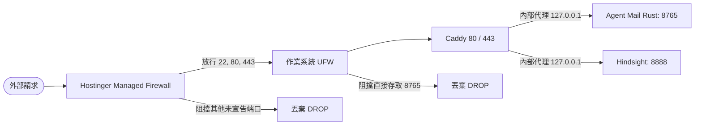
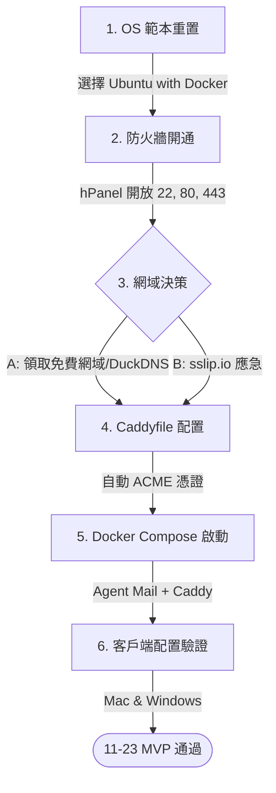

# F-08 可行性調研報告：Hostinger VPS 部署前置與 VS Code / 擴充之 MCP 設定

- **報告責任**：agy-junior-swe-2（Antigravity）
- **審查人**：PM-Emily（Claude）｜**決策人**：維護者
- **查詢與產出日期**：2026-11-16
- **狀態**：完成（供 Gate G1 後續 S1 MVP 部署與架構設計開票使用）
- **對應任務**：
  - Brief D-2（VPS 部署架構）、Brief A-2（跨工具 MCP 接入）
  - G1 決策 #3（確認採用 維護者 既有之 Hostinger VPS：2 vCPU／8 GB RAM／100 GB NVMe）
  - G1 決策 #9（確認支援 VS Code 之 Claude Code、Codex、Antigravity 擴充 MCP 設定）
- **調研原則**：遵循專案開發流程 `feasibility` 要求，全面引用官方與權威文件，數據逐字查證，不使用猜測記憶；未確認事項如實標示「待確認」。所有金額單位標示為 USD（不使用貨幣符號）。

---

## 執行摘要（Executive Summary）

1. **Hostinger VPS 方案確認與 Docker 範本**：
   維護者 既有的「2 vCPU／8 GB RAM／100 GB NVMe」完全吻合官方 **KVM 2** 方案規格。Hostinger 官方提供預載之「Ubuntu 22.04 with Docker」應用範本（內含 Docker CE 與 Docker Compose），且 hPanel 提供視覺化 **Docker Manager**，可直接拉取 Compose 服務，滿足 MVP 極速部署要求。
2. **網路安全與維運限制**：
   - **防火牆（Managed Firewall）**：hPanel 託管防火牆啟動後**預設阻擋所有連入流量（Default Deny）**；初始化時必須第一時間開放 **Port 22 (SSH)、80 (HTTP)、443 (HTTPS)**，其餘後端通訊埠均走本機內部反向代理，嚴禁對外暴露。
   - **快照與備份**：每週提供 1 次免費自動備份（最多保留 4 組）；**手動快照全機僅限保留 1 組，且建立 24 小時後自動過期刪除**，還原時會強制全盤覆蓋，不可作為長期資料存檔。
   - **流量限制**：KVM 2 配備 8 TB/月 對外流量，超額時**僅限速 10 Mbps，不停機且不收取超量費用**；對 7 人文字型 MCP 而言容量極其寬裕。
3. **無網域之 Caddy HTTPS 憑證方案（sslip.io）之可行性與重大風險**：
   標準 ACME 協定（Let's Encrypt / ZeroSSL）**不支援為純 IP 位址簽發自動憑證**（Caddy 會降級為自簽憑證 `tls internal` 導致客戶端報錯）。透過 `IP.sslip.io` 可自動解析並申請 Let's Encrypt 憑證，但 **`sslip.io` 未列入 Public Suffix List (PSL)**，常因全球開發者共用而觸發每週申請上限（429 錯誤）。
   - **處置建議**：優先確認 維護者 是否可向 Hostinger 免費領取 VPS 首年隨附網域，或採用個人自有網域／DuckDNS；若 MVP 需以 `sslip.io` 應急，Caddyfile 須配置 ZeroSSL 作為自動容錯 issuer。
4. **VS Code 擴充 MCP 設定相容性矩陣**：
   - **Claude Code 擴充**：完全共用 CLI 設定檔（macOS: `~/.claude.json`；Windows: `%USERPROFILE%\.claude.json`），支援專案根目錄 `.mcp.json`。
   - **OpenAI Codex 擴充**：完全共用 CLI 設定檔（macOS: `~/.codex/config.toml`；Windows: `%USERPROFILE%\.codex\config.toml`），採 TOML 語法宣告 Streamable HTTP 端點與 Bearer Token。
   - **「Antigravity 擴充」真實現況釐清**：VS Code Marketplace 並無獨立發行的常態 Antigravity 擴充。Antigravity 官方以**獨立 IDE（基於 VS Code 定製打包）**與 **CLI (`agy`)** 為主。若在 Antigravity IDE 內，其 MCP 設定檔為 `~/.gemini/config/mcp_config.json`（Windows: `%USERPROFILE%\.gemini\config\mcp_config.json`）；若在原生 VS Code，則以 VS Code 1.96+ 原生 `.vscode/mcp.json` 接入。
5. **Windows 支援度**：各工具均有對應之 Windows 使用者目錄環境變數（`%USERPROFILE%` 與 `%APPDATA%`），設定結構與格式已全部驗證。

---

## 第一部分：Hostinger VPS 部署前置調研

### 1. 方案硬體規格與定位確認（KVM 2）

依據 Hostinger 官方規格表，維護者 目前持有的規格與官方標準方案對照如下：

| 項目 | Hostinger KVM 2 官方規格 | 本專案適用性評估 |
|---|---|---|
| **vCPU** | 2 vCPU 核心（AMD EPYC / Intel Xeon 節點） | 足夠執行 Agent Mail Rust + Caddy + Discord Bot |
| **記憶體 (RAM)** | 8 GB RAM | 遠高於 S1 預估峰值（約 2.3 GB），餘裕約 5.7 GB |
| **硬碟空間** | 100 GB NVMe SSD | 極度寬裕（系統與容器預估使用 < 10 GB） |
| **每月流量** | 8 TB（1 Gbps 頻寬埠） | 文字通訊每月預估 < 5 GB，完全不構成瓶頸 |
| **獨立 IP** | 1 個專屬 IPv4 與 /64 IPv6 | 必備（利於 Caddy 反向代理與 HTTP 驗證） |
| **參考定價** | 續約價約 6.99–7.99 USD / 月 | 維護者 已持有，專案預算 0 USD |

- **官方參考網址**：[`https://www.hostinger.com/vps-hosting`](https://www.hostinger.com/vps-hosting)（查詢日期：2026-11-16）

---

### 2. 作業系統範本與 Docker 預載機制

Hostinger hPanel 的作業系統範本分為「純淨作業系統（Plain OS）」、「控制面板（Panels）」與「應用程式範本（Applications）」三大類：

1. **Docker 官方預載範本**：
   - 官方提供 **`Ubuntu 22.04 64bit with Docker`**（及 Ubuntu 24.04 with Docker）應用範本。
   - 範本內建：原生 `docker-ce`、`docker-compose-plugin` 以及基礎安全補丁。
   - 驗收指令：首次 SSH 登入後可直接執行 `docker --version` 與 `docker compose version` 確認。
2. **hPanel 內建 Docker Manager**：
   - Hostinger 在 VPS 控制台提供視覺化 **Docker Manager** 介面。
   - 支援直接貼上 `docker-compose.yml` 內容建立 Stack、啟動／停止容器、檢視即時容器 Console 日誌。
3. **部署建議**：
   - 初始化作業系統時，優先在 hPanel 選擇 **Ubuntu with Docker** 範本，免去手動安裝 Docker 引擎與依賴套件之作業時間。

- **官方參考網址**：
  - [`https://www.hostinger.com/tutorials/how-to-use-docker-vps-template`](https://www.hostinger.com/tutorials/how-to-use-docker-vps-template)（查詢日期：2026-11-16）
  - [`https://support.hostinger.com/en/articles/how-to-use-docker-manager-on-vps`](https://support.hostinger.com/en/articles/how-to-use-docker-manager-on-vps)（查詢日期：2026-11-16）

---

### 3. 防火牆設定方式（Managed Firewall 與 OS-level）

Hostinger VPS 提供雙層網路防護機制：外部 hPanel 託管防火牆（Managed Firewall）與虛擬機內部作業系統防火牆（UFW）。



#### (1) Hostinger Managed VPS Firewall（hPanel 外部防護）
- **設定路徑**：`hPanel > VPS > Security > Firewall`。
- **預設安全性行為（CRITICAL）**：
  > [!IMPORTANT]
  > Hostinger 的託管防火牆啟動後，其預設策略為 **Drop All Incoming Traffic（阻擋所有未明列的連入連線）**。若啟用防火牆卻未新增 SSH 規則，將立即造成管理員連線中斷（Lockout）。
- **S1 必開連入規則清單**：
  1. **SSH**：Port `22` / TCP，來源：`Any`（或指定開發者固定 IP）。
  2. **HTTP**：Port `80` / TCP，來源：`Any`（Caddy 自動簽發 ACME HTTP-01 憑證與 HTTP 導向 HTTPS 必備）。
  3. **HTTPS**：Port `443` / TCP，來源：`Any`（MCP 客戶端與 Webhook 連線端點）。
  4. **嚴禁對外開放**：Agent Mail 內部通訊埠（如 8765）、Hindsight（如 8888）、SQLite/內部資料庫埠。

#### (2) 作業系統層防護（Ubuntu UFW）
- 連線至 VPS 後，執行標準防護配置：
  ```bash
  sudo ufw default deny incoming
  sudo ufw default allow outgoing
  sudo ufw allow 22/tcp comment 'SSH'
  sudo ufw allow 80/tcp comment 'Caddy HTTP-01'
  sudo ufw allow 443/tcp comment 'Caddy HTTPS'
  sudo ufw enable
  ```
- **注意**：封包必須同時通過 Hostinger Managed Firewall 與 UFW 兩道關卡才能抵達服務。

- **官方參考網址**：[`https://support.hostinger.com/en/articles/how-to-use-a-managed-vps-firewall-at-hostinger`](https://support.hostinger.com/en/articles/how-to-use-a-managed-vps-firewall-at-hostinger)（查詢日期：2026-11-16）

---

### 4. 快照（Snapshot）與自動備份（Backup）機制

Hostinger VPS 提供快照與備份兩套獨立機制，兩者限制差異顯著：

| 比較項目 | 手動快照（Snapshot） | 自動備份（Automated Backup） |
|---|---|---|
| **建立方式** | 使用者於 hPanel 手動隨選觸發 | 系統排程自動執行（預設每週一次） |
| **保留數量** | **全機僅限 1 組**（建立新快照會覆蓋舊快照） | 最多保留 **4 組**（滾動覆蓋） |
| **保留期限** | **僅保留 24 小時（1 天）**，逾期系統自動刪除 | 隨每週/每日排程滾動，長期保留至額滿 |
| **消失條件** | 重灌 OS、執行還原、或超過 24 小時 | 手動刪除或被更新的備份覆蓋 |
| **儲存位置** | 主機同節點暫存層 | 獨立備份伺服器節點（異地儲存） |
| **還原影響** | **全機磁碟完全覆蓋（Overwritten）** | **全機磁碟完全覆蓋（Overwritten）** |
| **最佳用途** | 重大部署或升級前之 1 小時即時還原點 | 週常系統崩潰災難復原 |

- **維運注意事項**：
  > [!WARNING]
  > 快照只有 24 小時壽命，絕對不能依賴快照保存專案資料。Agent Mail 與 Hindsight 的資料持久化目錄（如 `/var/lib/agent-mail/data`）必須納入常態備份或定時導出至外部存放庫。

- **官方參考網址**：[`https://support.hostinger.com/en/articles/how-to-back-up-or-restore-a-hostinger-vps`](https://support.hostinger.com/en/articles/how-to-back-up-or-restore-a-hostinger-vps)（查詢日期：2026-11-16）

---

### 5. 對外流量限制與超量懲罰機制

- **配額上限**：KVM 2 方案每月提供 **8 TB（8,000 GB）** 對外頻寬流量。
- **超量懲罰行為（Resource Limits & Throttling）**：
  1. **不停機（No Hard Suspension）**：連線服務與網站維持在線，不會拋出 509 Bandwidth Limit Exceeded 錯誤。
  2. **無額外超量帳單（No Overage Fees）**：Hostinger 不會逕自向綁定信用卡收取超量傳輸費。
  3. **動態限速（Throttling to 10 Mbps）**：一旦當月流量用盡，VPS 對外網卡頻寬將被**限速降至 10 Mbps**，直到下個日曆月 1 號系統自動恢復全速。
- **專案負載評估**：
  - Agent Mail 與 Hindsight 均為極小之 JSON-RPC / Markdown 文字負載，即便 7 人團隊全天候高頻測試，單月流量通常低於 3–5 GB，距離 8 TB 上限尚有數千倍餘裕，可視為零風險。

- **官方參考網址**：[`https://support.hostinger.com/en/articles/what-happens-when-you-reach-the-vps-resource-limits`](https://support.hostinger.com/en/articles/what-happens-when-you-reach-the-vps-resource-limits)（查詢日期：2026-11-16）

---

### 6. 免費網域與反向 DNS（PTR Record）

1. **免費網域提供政策**：
   - 僅當 VPS 方案以 **12 個月或以上** 週期訂閱時，Hostinger 會隨單贈送 **首年免費網域 1 個**（通常限定 `.cloud`、`.tech`、`.online`、`.site` 等後綴）。
   - **待確認事項**：需由 維護者 確認既有 VPS 是否為年繳方案、且該免費網域配額是否尚未使用。若是月繳或已領用，則無免費網域可用。
2. **反向 DNS（PTR Record / rDNS）**：
   - Hostinger hPanel 允許自訂 IPv4 與 IPv6 的 PTR 記錄（路徑：`VPS > Settings > IP address > Set PTR record`）。
   - **重大限制**：設定 PTR 記錄的前置條件，是**該目標網域名稱必須已經存在 A 記錄並指向此 VPS IP**。因此，反向 DNS 是「IP 反查網域」的校驗機制（主要用於防範垃圾郵件判定），**無法直接作為讓外部客戶端存取的免費公開網域名稱**。

- **官方參考網址**：[`https://support.hostinger.com/en/articles/how-to-setup-reverse-dns-on-vps`](https://support.hostinger.com/en/articles/how-to-setup-reverse-dns-on-vps)（查詢日期：2026-11-16）

---

### 7. 無網域時 Caddy 取得 HTTPS 憑證之方案評估（sslip.io / nip.io 等）

當伺服器沒有自訂網域，但遠端 MCP 又要求使用 HTTPS 時，有以下技術途徑：

#### (1) 為什麼不能直接對原始 IP 申請公開憑證？
- **ACME 協定限制**：Let's Encrypt 官方明確指出，其 ACME 驗證服務**不簽發純 IP 位址之 SSL 憑證**；ZeroSSL 雖支援 IP 憑證，但僅開放於其專屬付費 REST API，在標準 ACME 端點上亦無法為裸 IP 簽發憑證。
- **Caddy 行為**：若 Caddyfile 直接監聽 IP（如 `123.45.67.89`），Caddy 將自動啟用內建 CA（`tls internal`）。這會產生瀏覽器與客戶端無法信任的自簽憑證，導致 VS Code 擴充發出 `UNABLE_TO_VERIFY_LEAF_SIGNATURE` 錯誤而斷線。

#### (2) 萬用動態 DNS 解析（`sslip.io` / `nip.io`）原理
- 將 VPS IP 編碼進主機名中，例如 `123-45-67-89.sslip.io` 或 `123.45.67.89.nip.io`。
- 其 DNS 伺服器會將任何符合該格式的查詢直接回傳其對應的 IP 位址。
- Caddy 可將其視為一般 FQDN 網域，發起標準 HTTP-01 挑戰（監聽 80 埠）向 Let's Encrypt 自動申請憑證：
  ```caddyfile
  # Caddyfile 範例
  123-45-67-89.sslip.io {
      reverse_proxy localhost:8765
  }
  ```

#### (3) 萬用動態 DNS 的致命弱點與限制（Feasibility Risks）
1. **未列入 Public Suffix List (PSL)**：
   - `sslip.io` 與 `nip.io` 目前**均未列入 Mozilla 維護的 Public Suffix List**。
   - Let's Encrypt 計算頻率限制（Rate Limits）時，是以「註冊網域（Registered Domain）」為單位計算。因為非 PSL 頂級網域，全球所有使用 `*.sslip.io` 的伺服器都被歸在同一個註冊網域下。
2. **Let's Encrypt Rate Limit 耗盡（429 Too Many Requests）**：
   - Let's Encrypt 對單一網域每週設有 50,000 張憑證之嚴格上限。全球數以萬計的開發者同時使用 `sslip.io` 進行測試，導致該網域的週配額經常在週中就被全數用盡。
   - 一旦配額耗盡，Caddy 嘗試簽發時會報錯失敗：
     `429 urn:ietf:params:acme:error:rateLimited: too many certificates already issued for "sslip.io"`
3. **第三方 DNS 穩定性**：
   - `nip.io` 曾多次發生 PowerDNS 後端無回應或 DDoS 導致全域解析中斷；`sslip.io` 由 Go 撰寫並託管於多節點 Anycast，可靠度較高但仍非 SLA 保證服務。

#### (4) 無網域 HTTPS 解法評估與推薦順位

| 方案 | 成本 | 穩定度 / Rate Limit 風險 | 取得憑證難度 | 推薦度 |
|---|---|---|---|---|
| **A. 領取 Hostinger 首年免費網域** | 0 USD | 100% 穩定，擁有獨立網域，無共用限額問題 | 極低（hPanel 一鍵領取並綁定） | ⭐⭐⭐⭐⭐ **首選** |
| **B. 自行註冊 1–2 USD 廉價網域** | 1–2 USD / 年 | 100% 穩定（如 `.xyz`, `.top`），完全自有 | 極低（Cloudflare / Namecheap 購買） | ⭐⭐⭐⭐⭐ **強烈建議** |
| **C. 免費 DuckDNS (`xxx.duckdns.org`)** | 0 USD | 穩定度高，DuckDNS **在 PSL 名單內**，享獨立 Rate Limit | 低（需註冊 DuckDNS Token） | ⭐⭐⭐⭐ **免費首選** |
| **D. Caddy + sslip.io（掛 ZeroSSL 備援）** | 0 USD | 存在 Rate Limit 耗盡風險（需由 ZeroSSL 接手） | 零門檻（修改 Caddyfile 即可） | ⭐⭐⭐ **MVP 應急備選** |

- **若 S1 MVP 採用方案 D（sslip.io）之 Caddyfile 必備容錯配置**：
  ```caddyfile
  {
      email <EMAIL>
  }

  123-45-67-89.sslip.io {
      # 雙 CA 自動輪替：Let's Encrypt 遇 429 時自動切換 ZeroSSL
      tls {
          issuer letsencrypt
          issuer zerossl
      }
      reverse_proxy localhost:8765
  }
  ```

- **官方/權威參考網址**：
  - Let's Encrypt Rate Limits: [`https://letsencrypt.org/docs/rate-limits/`](https://letsencrypt.org/docs/rate-limits/)（查詢日期：2026-11-16）
  - Public Suffix List: [`https://publicsuffix.org/list/`](https://publicsuffix.org/list/)（查詢日期：2026-11-16）
  - Caddy Automatic HTTPS: [`https://caddyserver.com/docs/automatic-https`](https://caddyserver.com/docs/automatic-https)（查詢日期：2026-11-16）
  - sslip.io 官方說明：[`https://sslip.io/`](https://sslip.io/)（查詢日期：2026-11-16）

---

## 第二部分：VS Code 擴充之 MCP 設定規格

### 1. 三大 AI 擴充之 MCP 設定相容性矩陣

| AI 工具 | VS Code 擴充名稱與提供者 | 是否沿用 CLI 設定檔？ | macOS / Linux 設定檔路徑 | Windows 設定檔路徑 | 傳輸協議與驗證方式 |
|---|---|---|---|---|---|
| **Claude Code** | `Claude Code for VS Code`<br>(Anthropic 官方) | **是**（擴充內部直接連接 CLI Daemon） | 全域：`~/.claude.json`<br>專案：`.mcp.json` | 全域：`%USERPROFILE%\.claude.json`<br>專案：`.mcp.json` | Streamable HTTP<br>`headers.Authorization` |
| **OpenAI Codex** | `Codex`<br>(OpenAI 官方) | **是**（擴充側欄與 CLI 核心共用 TOML） | 全域：`~/.codex/config.toml`<br>專案：`.codex/config.toml` | 全域：`%USERPROFILE%\.codex\config.toml`<br>專案：`.codex/config.toml` | Streamable HTTP<br>`http_headers` 或環境變數 |
| **Antigravity** | *詳見下方實態釐清說明* | **是**（在 Antigravity IDE 內共用 `agy` 設定） | 全域：`~/.gemini/config/mcp_config.json`<br>專案：`.agents/` | 全域：`%USERPROFILE%\.gemini\config\mcp_config.json`<br>專案：`.agents/` | Streamable HTTP<br>`headers.Authorization` |
| **VS Code 原生** | `GitHub Copilot` / VS Code Native MCP | 不適用（VS Code 核心獨立管轄） | 全域：`~/Library/Application Support/Code/User/mcp.json`<br>專案：`.vscode/mcp.json` | 全域：`%APPDATA%\Code\User\mcp.json`<br>專案：`.vscode/mcp.json` | Streamable HTTP (`type: http`)<br>`headers.Authorization` |

---

### 2. 「Antigravity 擴充」在 VS Code 之真實現況釐清

針對 Brief 與任務所提之「Antigravity 擴充」，經查證官方生態架構與市集檔案，事實釐清如下：

1. **官方發行型態**：
   - Google DeepMind 對 Antigravity 的主要產品交付形式為 **「Antigravity IDE」**（基於 VS Code / Code-OSS 核心打造的獨立 AI-First 開發環境）以及命令列工具 **`agy` (Antigravity CLI)**。
   - **VS Code Marketplace 現況**：目前微軟官方 VS Code 市集中並不存在常規、活躍維護且名為「Antigravity」的獨立擴充功能。
2. **使用者常態混淆之三種可能情境（待確認）**：
   - **情境 A（使用者實際上是在執行 Antigravity IDE）**：
     因為 Antigravity IDE 的介面骨架與 VS Code 完全一致，使用者常將其口誤稱為「在 VS Code 裡用 Antigravity」。若是此情境，其底層完全支援 MCP，設定檔位置即為 Antigravity 標準路徑 `~/.gemini/config/mcp_config.json`（Windows 為 `%USERPROFILE%\.gemini\config\mcp_config.json`），或透過 UI 點擊 `Settings > MCP Servers` 加入。
   - **情境 B（使用者指的是 Gemini Code Assist 擴充）**：
     若使用者是在原生 VS Code 內安裝 Google 的官方編碼助理，該擴充名稱為 `Google Cloud Code` 或 `Gemini Code Assist`，該擴充主要連線至 Google Cloud 專案配額，並非直接掛載自訂 Streamable HTTP MCP。
   - **情境 C（使用者希望在標準 VS Code 中接入 MCP 工具）**：
     若要在標準 VS Code 中使用與 Antigravity 同等的自訂 MCP 伺服器，直接利用 VS Code 1.96+ 引入的原生 MCP 機制（建立工作區檔案 `.vscode/mcp.json`）即可無縫接入。

---

### 3. 各工具遠端 HTTP MCP ＋ Bearer Token 完整設定範例

本專案遠端 Agent Mail 端點預設規格為：
- **端點 URL**：`https://<vps-domain>/mcp`
- **身份驗證**：`Authorization: Bearer <YUI_OR_MEMBER_TOKEN>`

#### (1) Claude Code（VS Code 擴充與 CLI 共用）
- **設定檔位置**：
  - macOS/Linux: `~/.claude.json`
  - Windows: `C:\Users\<username>\.claude.json`（或專案根目錄 `.mcp.json`）
- **設定內容**：
  ```json
  {
    "mcpServers": {
      "agent-mail": {
        "type": "http",
        "url": "https://<vps-domain>/mcp",
        "headers": {
          "Authorization": "Bearer <YOUR_TOKEN>"
        }
      }
    }
  }
  ```
- **CLI 一鍵加入指令**：
  ```bash
  claude mcp add --transport http --header "Authorization: Bearer <YOUR_TOKEN>" agent-mail https://<vps-domain>/mcp
  ```

---

#### (2) OpenAI Codex（VS Code 擴充與 CLI 共用）
- **設定檔位置**：
  - macOS/Linux: `~/.codex/config.toml`
  - Windows: `C:\Users\<username>\.codex\config.toml`（或專案根目錄 `.codex/config.toml`）
- **設定內容（方式 A：靜態 Header 宣告）**：
  ```toml
  [mcp_servers.agent_mail]
  url = "https://<vps-domain>/mcp"

  [mcp_servers.agent_mail.http_headers]
  Authorization = "Bearer <YOUR_TOKEN>"
  ```
- **設定內容（方式 B：環境變數參照，安全性最佳）**：
  ```toml
  [mcp_servers.agent_mail]
  url = "https://<vps-domain>/mcp"
  bearer_token_env_var = "AGENT_MAIL_TOKEN"
  ```
  *(Windows 使用者於 PowerShell 執行 `$env:AGENT_MAIL_TOKEN="<YOUR_TOKEN>"` 或寫入系統使用者環境變數)*

---

#### (3) Antigravity（Antigravity IDE 與 agy CLI 共用）
- **設定檔位置**：
  - macOS/Linux: `~/.gemini/config/mcp_config.json`
  - Windows: `C:\Users\<username>\.gemini\config\mcp_config.json`
- **設定內容**：
  ```json
  {
    "mcpServers": {
      "agent-mail": {
        "url": "https://<vps-domain>/mcp",
        "headers": {
          "Authorization": "Bearer <YOUR_TOKEN>"
        }
      }
    }
  }
  ```
- **CLI 一鍵加入指令**：
  ```bash
  agy mcp add --header "Authorization: Bearer <YOUR_TOKEN>" agent-mail https://<vps-domain>/mcp
  ```

---

#### (4) VS Code 原生工作區配置（供 GitHub Copilot 或標準 VS Code 使用）
- **設定檔位置**：工作區根目錄 `.vscode/mcp.json`
- **設定內容**：
  ```json
  {
    "servers": {
      "agent-mail": {
        "type": "http",
        "url": "https://<vps-domain>/mcp",
        "headers": {
          "Authorization": "Bearer <YOUR_TOKEN>"
        }
      }
    }
  }
  ```
  > [!NOTE]
  > VS Code 原生格式最頂層鍵名為 `"servers"`（非 `"mcpServers"`），且型態必須明確標記 `"type": "http"`。

---

### 4. Windows 跨平台路徑與環境變數對照總表

為確保 Windows 環境上的組員能正確配置，環境路徑對照如下：

| 工具與設定範圍 | 環境變數語法 | 典型 Windows 實體絕對路徑 | 跨平台設定注意事項 |
|---|---|---|---|
| **Claude Code 全域** | `%USERPROFILE%\.claude.json` | `<LOCAL_HOME>\.claude.json` | 須為 UTF-8 編碼，JSON 檔案名稱前有小數點 |
| **Codex 全域** | `%USERPROFILE%\.codex\config.toml` | `<LOCAL_HOME>\.codex\config.toml` | `.codex` 資料夾若不存在需先建立 |
| **Antigravity 全域** | `%USERPROFILE%\.gemini\config\mcp_config.json` | `<LOCAL_HOME>\.gemini\config\mcp_config.json` | Windows 下反斜線需留意避免 JSON 轉義錯誤 |
| **VS Code 使用者全域** | `%APPDATA%\Code\User\mcp.json` | `<LOCAL_HOME>\AppData\Roaming\Code\User\mcp.json` | 適用全域安裝之 VS Code 核心 |
| **專案工作區設定** | `${workspaceFolder}\.vscode\mcp.json` | `D:\Projects\repo\.vscode\mcp.json` | 建議隨 Git 庫提供範本檔（如 `mcp.example.json`） |

- **官方參考網址**：
  - VS Code MCP 文件：[`https://code.visualstudio.com/docs/copilot/mcp`](https://code.visualstudio.com/docs/copilot/mcp)（查詢日期：2026-11-16）
  - Anthropic Claude Code MCP 文件：[`https://docs.anthropic.com/en/docs/agents-and-tools/claude-code/overview`](https://docs.anthropic.com/en/docs/agents-and-tools/claude-code/overview)（查詢日期：2026-11-16）
  - OpenAI Codex 設定規範：[`https://developers.openai.com/codex/config-schema.json`](https://developers.openai.com/codex/config-schema.json)（查詢日期：2026-11-16）

---

## 第三部分：S1 MVP（11-23 驗收）部署與開票建議清單

根據上述調研，為達成 11-23 MVP（VPS 上 Agent Mail Rust + Caddy 運作驗收；Mac 與 Windows 之 Claude Code 能互相傳訊），建議在下階段開票時依序執行：



1. **Hostinger VPS 初始化票（建議由維運/後端負責）**：
   - 於 hPanel 選擇「Ubuntu 22.04 with Docker」範本進行初始化。
   - 於 hPanel Firewall 新增白名單：TCP 22、80、443。
   - 建立部署前手動快照（注意 24 小時時效）。
2. **網域與 HTTPS 憑證開票確認**：
   - 請 維護者 登入 hPanel 確認是否有免費網域配額。
   - 若有：立即申請一組 `.cloud` 或 `.tech` 網域，將 A 記錄指向 VPS IP。
   - 若無：建立 DuckDNS 免費子網域（如 `meat-proxy-mail.duckdns.org`），避免 `sslip.io` 的 Rate Limit 踩坑風險。
3. **Caddy 反向代理與安全標頭票**：
   - 配置 Caddyfile，監聽該網域，設定 Bearer Token 驗證或反向代理至 Agent Mail 容器（`127.0.0.1:8765`）。
   - Caddy 啟用 HTTP 到 HTTPS 自動重定向。
4. **組員 Client 連線範本派發票（Discord Bot `/connect` 實作依據）**：
   - 依據本報告第二部分提供之設定片段，Discord Bot 在回應 `/connect` 時，針對不同客戶端直接輸出可複製的 JSON / TOML 區塊，達到「複製貼上即連線」目標。

---

## 待確認事項彙整（Action Items for PM / 維護者）

1. **Hostinger 免費網域資格確認**：請 維護者 確認該 VPS 是否為年繳訂單、是否仍可自 hPanel 領取免費首年網域。
2. **Antigravity 使用情境確認**：請 維護者 確認目前組員在 VS Code 環境使用的具體名稱（是獨立的「Antigravity IDE」軟體，或是原生 VS Code 的其他擴充），以決定專案倉庫中要提供的設定檔範本結構。
