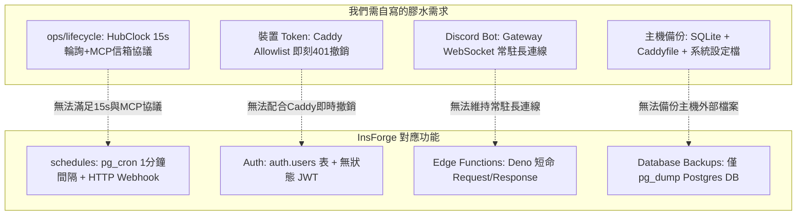

# F-10 可行性評估報告：InsForge 適用性調研（feasibility）

- **報告負責**：agy-junior-swe-1（Antigravity）
- **審查人**：PM-Emily（Claude）｜**決策人**：維護者
- **完成日期**：2026-11-17
- **狀態**：完成；PM 審查 2026-11-17
- **PM 審查註記**：已親自核對 schedules 最小間隔 1 分鐘（pg_cron）與免費方案 500 MB／1 GB／5 GB、閒置 1 週暫停、Pro 25 USD／月，屬實。「8 GB VPS 必崩潰」為誇大：7 GB 是 S3 五組全開的預估，MVP 只用約 1.9 GB；正確說法是「會吃掉 S3 所需的餘裕」。結論 (b) 採納。
- **上游依據**：
  - Brief（`docs/01-brief.md`，G1 已確認版）
  - G1 決策記錄（`docs/gates/G1-decision.md`）
  - 工作 DAG（`docs/00-DAG.md` 票 T14）
  - PRD（`docs/02-prd.md`）、SAD（`docs/04-sad.md`）、SDS（`docs/05-sds.md`）
  - 前期實測：`docs/research/F-01b-agent-mail-rust.md`、`docs/research/F-03-vps-llm-cost.md`、`docs/research/F-05-hindsight-spike.md`、`docs/research/F-06-discord-bridge.md`
- **評估對象**：[InsForge](https://insforge.dev/zh-TW)（GitHub：[InsForge/InsForge](https://github.com/InsForge/InsForge)，開源 Apache-2.0）
- **調研背景與原則**：
  - MVP 架構已核准（Caddy ＋ mcp_agent_mail_rust ＋ HubClock 計時；上線批次追加 Hindsight ＋ Discord bot）。
  - VPS 規格為 Hostinger 2 vCPU／8 GB RAM／100 GB NVMe，五組全開預估已占用約 7 GB，記憶體餘裕極為吃緊。
  - 本報告嚴格遵守「不建議推翻已核准架構」之原則，聚焦回答：「**InsForge 能否取代我們自己要寫的膠水程式？**」以及「**能否供組員團隊專題使用？**」。

---

## 摘要與結論（Executive Summary）

1. **結論三選一：強烈推薦 (b)「只推薦給組員做團隊專題」，絕不納入主系統。**
2. **對主系統自寫膠水無替代價值（省 0 行膠水程式）**：
   - **計時（HubClock）**：需求為 15 秒循環之 MCP 事件輪詢與逾時回信；InsForge 排程走 `pg_cron`，最小解析度為 1 分鐘且僅發送 HTTP 請求，完全不支援 Agent Mail MCP 協議，**省 0 行**。
   - **裝置 Token 發放／撤銷**：需求為每裝置一 Token 配合 Caddy 靜態 Allowlist 即刻 401 撤銷；InsForge 是使用者層級無狀態 JWT，無法即時與 Caddy 聯動，**省 0 行**。
   - **Discord Bot（/connect 與通知）**：需 Discord Gateway WebSocket 常駐長連線；InsForge Edge Functions 是短命 Request/Response 執行單元，無法維持 Gateway 連線，**省 0 行**。
   - **備份**：需求為備份 SQLite（Mail）與主機設定檔；InsForge 備份功能本質僅為針對自己 Postgres 的 `pg_dump`，無法備份主機外部檔案，**省 0 行**。
3. **主機資源致命風險（8 GB VPS 必崩潰）**：
   - 官方標準生產自架包含 4 個容器（`postgres`、`postgrest`、`insforge` 後端與儀表板、`deno` 執行環境）。
   - 官方文件載明測試最低需 2–4 GB RAM，生產推薦 8 GB RAM。Hostinger 8 GB VPS 在五組滿載（預估 7 GB）下若再部署 InsForge，必觸發 Linux OOM Killer 當機。
4. **重大安全破口（MCP 具備刪庫刪表能力）**：
   - InsForge 官方 MCP Server 提供之 `run-raw-sql` 工具直接綁定 `project_admin`（甚至 root）權限，無唯讀模式與白名單保護，Agent 可任意執行 `DROP TABLE`、`DELETE` 或 `TRUNCATE`，在多 Agent 自主協同環境下極度危險。
5. **極度適合組員團隊專題**：
   - 身為專為 AI Coding Agent（Cursor、Claude Code）打造的開源 Supabase 替代品，其免費雲端版或本機 Docker 開發極度便捷，能大幅加速組員團隊專題的前後端整合。

---

## 一、自架實際組成、RAM 需求與 Postgres 共用可行性

### 1.1 實際自架組成與容器清單

依據 InsForge 官方生產配置檔案 [`docker-compose.prod.yml`](https://github.com/InsForge/InsForge/blob/main/docker-compose.prod.yml)（查詢日期：2026-11-17），標準自架包含 **4 個核心容器**：

| 服務名稱 | 映像檔規格 | 核心用途與監聽 Port |
|---|---|---|
| **`postgres`** | `ghcr.io/insforge/postgres:v15.13.4` | 定制 PostgreSQL 15，內建 `pgvector`、`db-init.sql`（初始化 anon、authenticated、project_admin 角色與 RLS 觸發器）、`jwt.sql`。監聽本機 `127.0.0.1:5432`。 |
| **`postgrest`** | `postgrest/postgrest:v12.2.12` | 將 PostgreSQL Schema 自動映射為具備 RLS 安全控管的 RESTful API。監聽本機 `127.0.0.1:5430`。 |
| **`insforge`** | 多階構建 `runner`（Node.js / Express） | 平台核心後端與 Web 儀表板，提供使用者認證、資料庫進階 API、儲存閘道、AI 閘道與 MCP 橋接。對外開放 `7130`（API/UI）與 `7131`（Auth）。 |
| **`deno`** | `denoland/deno:alpine-2.0.6` | 邊緣運算函數（Edge Functions）之 Serverless 執行環境。監聽本機 `127.0.0.1:7133`。 |

> [!NOTE]
> 若啟用其「Custom Compute」功能，還需將宿主機的 `/var/run/docker.sock` 掛載進容器，進一步在主機動態調度獨立的 Docker 容器。

### 1.2 官方 RAM 需求數字

經查證 InsForge 官方部署文件，其硬體需求如下（非空載想像，皆有官方文件背書）：

1. **AWS EC2 部署指引**（[deploy-to-aws-ec2.md](https://github.com/InsForge/InsForge/blob/main/docs/deployment/deploy-to-aws-ec2.md)，查詢日期：2026-11-17）：
   - **測試環境最低需求**：`t3.small`（**2 vCPU, 2 GB RAM**）。
   - **推薦基準規格**：`t3.medium`（**2 vCPU, 4 GB RAM**）。
   - **生產環境推薦規格**：`t3.large`（**2 vCPU, 8 GB RAM**）。
2. **Hetzner Cloud 部署指引**（[deploy-to-hetzner.md](https://github.com/InsForge/InsForge/blob/main/docs/deployment/deploy-to-hetzner.md)，查詢日期：2026-11-17）：
   - **測試規格**：`CX23`（**2 vCPU, 4 GB RAM**, 40 GB 磁碟）。
   - **生產規格**：`CX33`（**4 vCPU, 8 GB RAM**, 80 GB 磁碟）。
3. **對現有 VPS 負載之評估**：
   - 維護者 既有的 Hostinger VPS 規格為 **2 vCPU / 8 GB RAM**（系統可用總量約 7,629 MiB）。
   - 依據 `docs/04-sad.md` 資源預算表，上線批次在五組滿載時（5 組 Agent Mail + Hindsight + Caddy + Discord bot + SQLite + Host ops 計時），記憶體預算已高達約 **7 GB**。
   - 若在同一台 VPS 額外啟動 InsForge 4 個容器，光啟動與底層依賴（Node.js、Deno、PostgREST、Postgres）至少再吃掉 **1.5 GB 至 2 GB RAM**，伺服器總消耗將突破 8.5 GB 以上，必定觸發 Linux OOM Killer 導致核心服務中斷。

### 1.3 能否與 Hindsight 的 Postgres 共用？

**結論：技術上可能連線，但架構與安全上有致命衝突，強烈不可行。**

- **原因 1：RLS 觸發器污染與資料外洩**
  InsForge 啟動時會在資料庫注入 `deploy/docker-init/db/db-init.sql`（[db-init.sql](https://github.com/InsForge/InsForge/blob/main/deploy/docker-init/db/db-init.sql)，查詢日期：2026-11-17），其中包含全域事件觸發器 `create_default_policies()`，任何在 `public` schema 建立的資料表都會被強制改寫權限。此外，PostgREST 會自動掃描 `public` 下的所有表並生成公開 REST API。若 Hindsight 記憶表置於同處，極易因 PostgREST 暴露或因 RLS 規則衝突導致記憶讀寫異常。
- **原因 2：MCP 高權限穿透風險**
  InsForge 的 MCP 提供 `run-raw-sql` 工具，使用 `project_admin` 角色連線。若與 Hindsight 共用 Instance，任何連接 InsForge 的 Agent 都能透過 Raw SQL 任意讀取、竄改或 `DROP` Hindsight 的專案記憶庫。
- **原因 3：違背 SAD 既定之網路與安全性隔離**
  `docs/04-sad.md` §75–77 明確規定「Mail 不加入共享資料庫網；bank-proxy 才能到 Hindsight；Hindsight 才能到 db」。共用 InsForge 的 Postgres 將打破此一單向隔離屏障。
- **原因 4：記憶體節省微乎其微**
  共用 Postgres 頂多省下一個 Postgres 背景行程（約 50–100 MB RAM），但無法省去 InsForge 的 `insforge` 後端（Node.js 約 300–500 MB）、`postgrest`（約 50–100 MB）與 `deno`（約 100–200 MB），依然無法挽救 VPS 記憶體爆掉的事實。

---

## 二、逐項對照自寫膠水：能否取代與節省程式碼分析

本專案自寫之膠水模組主要包含四大項，經與 InsForge 功能逐一比對：



### 2.1 ops/lifecycle 計時（排程 jobs？）
- **自寫膠水需求（`docs/05-sds.md` API-06）**：
  - 專用服務 Agent `HubClock`，目標每 15 秒循環一次。
  - 監聽 Agent Mail 收件匣中的 CC 控制事件（question、presented、answer、choice、session.closed）。
  - 維護計時狀態，逾 24 小時未答或逾 30 分鐘確認超時時，透過 Agent Mail 原生 MCP JSON-RPC 於原串發信並標記逾時。
- **InsForge 規格（[schedules.mdx](https://github.com/InsForge/InsForge/blob/main/docs/core-concepts/functions/schedules.mdx)，查詢日期：2026-11-17）**：
  - 基於 PostgreSQL 的 `pg_cron` 擴充套件，在固定 Cron 表達式觸發時，向指定 URL 發送 HTTP 請求。
  - **限制 1（解析度不符）**：官方文件明訂最小間隔為 **1 分鐘**（無秒級），無法達成 15 秒檢查目標。
  - **限制 2（通訊協議不符）**：`pg_cron` 僅能打 HTTP URL，完全不支援 Agent Mail 的 MCP 通訊協議與本地狀態維護。
- **結論**：**無法取代，節省 0 行**。即使強行每分鐘打一次 Deno 函數，函數內部依然得從頭手寫連接 Agent Mail MCP、解析 envelope、記錄超時狀態並回覆的完整邏輯。

### 2.2 裝置 token 發放／撤銷（auth？能否配合 Caddy）
- **自寫膠水需求（`docs/04-sad.md` §14, 64）**：
  - 依 維護者 定案為「每裝置一 Token」，撤銷時僅影響該台特定裝置。
  - Caddy 在 TLS 入口（80/443）驗證 Bearer Token，撤銷時直接更新本地清單並執行 `caddy reload`，實現 sub-millisecond 等級的立即 401 拒絕。
- **InsForge 規格（[authentication/overview.mdx](https://github.com/InsForge/InsForge/blob/main/docs/core-concepts/authentication/overview.mdx)，查詢日期：2026-11-17）**：
  - 專為終端使用者設計（以 `auth.users` 表為基礎，支援 Email、OAuth、Magic Link），簽發具時效的非對稱/對稱 JWT。
  - **限制 1（顆粒度不符）**：沒有原生以「裝置」為單位的管理機制。
  - **限制 2（無法即時撤銷）**：標準 JWT 為無狀態驗證，Caddy 若只驗簽章，無法即時撤銷已被洩漏的 Token；若改用 Caddy `forward_auth` 每次打 InsForge 驗證，每筆 MCP 請求都多一趟 HTTP 往返延遲，且 InsForge 一旦維護重啟，全系統通訊瞬間停擺。
- **結論**：**無法取代，節省 0 行**。欲配合 Caddy 仍需額外手寫 Sync 腳本將資料匯出給 Caddy，徒增架構依賴。

### 2.3 Discord bot 的 /connect 與通知（edge functions？）
- **自寫膠水需求（`docs/research/F-06-discord-bridge.md`、`docs/04-sad.md` §58）**：
  - 以開源 `js-llmcord` 為底的 Node.js 常駐行程，透過 Discord Gateway WebSocket (`wss://gateway.discord.gg`) 保持長連線。
  - 監聽 Slash Commands（`/connect`、`/status`）與按鈕交互，並在接收到 Agent Mail 事件時將訊息推入 Discord 頻道。Bot 為主動對外連線，無需對外開放 Inbound Port。
- **InsForge 規格（[functions/overview.mdx](https://github.com/InsForge/InsForge/blob/main/docs/core-concepts/functions/overview.mdx)，查詢日期：2026-11-17）**：
  - Edge Functions 運行於 Deno，為無狀態、短生命週期的 Serverless 單元（官方文件特別註記："Need a process that stays up? Use Compute... Edge Functions are for request/response and short-lived jobs"）。
  - **限制 1（無法長連線）**：無法維持 Discord Gateway WebSocket 長連線與心跳包（Heartbeat）。
  - **限制 2（需暴露公網與重寫）**：若改採 Discord Interactions Webhook，必須在 Caddy 開放公網端點並自寫 Ed25519 簽名校驗，且失去 Agent Mail 主動推播給使用者的通知管道。
- **結論**：**無法取代，節省 0 行（若嘗試適配反而多出數百行程式碼）**。直接執行現成的 `js-llmcord` 容器遠比拆解至 Edge Functions 單純且穩定。

### 2.4 備份（Backups）
- **自寫膠水需求（`docs/04-sad.md` §99）**：
  - 每日備份 Agent Mail 的專案 SQLite 資料庫（`/data/projects/...`）、Caddyfile、憑證與 HubClock 狀態檔。
- **InsForge 規格（[backups.mdx](https://github.com/InsForge/InsForge/blob/main/docs/core-concepts/database/backups.mdx)，查詢日期：2026-11-17）**：
  - 官方文件明文規定："Backups cover the database only — files uploaded to Storage are not included."。
  - 其備份機制僅是在自架環境內調用 `pg_dump` 備份 InsForge 自身的 PostgreSQL。
- **結論**：**無法取代，節省 0 行**。Agent Mail 的 SQLite 與系統檔案依然必須依賴 Host-level 的 rsync/tar 腳本執行。

---

## 三、MCP Server 功能、工具清單與權限邊界（安全評估）

### 3.1 官方 MCP Server 套件與清單

InsForge 官方提供開源 MCP Server（GitHub：[`InsForge/insforge-mcp`](https://github.com/InsForge/insforge-mcp)，查詢日期：2026-11-17；npm：`@insforge/mcp`）。

經查閱其原始碼 [`src/shared/tools/index.ts`](https://github.com/InsForge/insforge-mcp/blob/master/src/shared/tools/index.ts)，共註冊了 **18 個工具**，分為五大領域：

| 分類 | 註冊工具名稱 | 工具功能說明 |
|---|---|---|
| **資料庫 (Database)** | `get-table-schema`<br>`get-backend-metadata`<br>`run-raw-sql`<br>`bulk-upsert`<br>`download-template` | 取得指定表之結構（含 RLS、索引、約束）。<br>取得全後端元資料索引。<br>**執行任意原始 SQL 查詢（具備 Admin 權限）。**<br>自 CSV/JSON 批量匯入／Upsert 資料。<br>下載前端 React/Next.js 範本框架。 |
| **邊緣函數 (Functions)** | `create-function`<br>`get-function`<br>`update-function`<br>`delete-function` | 在 Deno 執行環境建立新 Edge Function。<br>讀取特定 Edge Function 之程式碼與資訊。<br>更新現有 Edge Function 程式碼或元資料。<br>**永久刪除特定 Edge Function。** |
| **儲存 (Storage)** | `create-bucket`<br>`list-buckets`<br>`delete-bucket` | 建立新的 S3 相容儲存貯體。<br>列出所有儲存貯體。<br>**刪除特定儲存貯體及其內容。** |
| **部署維運 (Deployment)** | `get-container-logs`<br>`create-deployment`<br>`start-deployment` | 讀取指定容器／服務之最新除錯日誌。<br>準備程式碼部署上傳命令。<br>觸發建置與發布程序。 |
| **文件與金鑰 (Docs & Auth)** | `fetch-docs`<br>`fetch-sdk-docs`<br>`get-anon-key` | 檢索 InsForge 核心與 SDK 開發文件。<br>依程式語言檢索特定 SDK 指南。<br>產出客戶端使用的匿名 JWT Token。 |

### 3.2 權限範圍分析：Agent 能不能刪資料、刪表？

> [!CAUTION]
> **重大安全確認：Agent 絕對可以刪除資料，也絕對可以刪除整張資料表（DROP TABLE）！**

1. **`run-raw-sql` 具備最高專案管理員權限**：
   - 檢視 `src/shared/tools/database.ts`：
     ```typescript
     registerTool(
       'run-raw-sql',
       'Execute raw SQL query with optional parameters. Admin access required. Use with caution as it can modify data directly.',
       ...
     ```
   - 檢視後端路由 [`backend/src/api/routes/database/advance.routes.ts`](https://github.com/InsForge/InsForge/blob/main/backend/src/api/routes/database/advance.routes.ts)（查詢日期：2026-11-17）：
     該工具將查詢發送至 `POST /api/database/advance/rawsql`，使用 `verifyAdmin` 檢查通過後，直接以 **`project_admin`（甚至 root）** 身份在 PostgreSQL 執行！
   - **能執行的危險指令**：包含但不限於 `DROP TABLE`、`ALTER TABLE`、`TRUNCATE`、`DELETE FROM <table> WHERE ...`。
2. **缺乏防禦限制**：
   - 沒有唯讀連線模式（Read-Only Mode）。
   - 沒有資料表存取白名單或黑名單防護機制。
   - 官方在 `advance.routes.ts` 的 `importDatabase` 介面中甚至提供 `truncate: true` 參數直接清空整表。
3. **對本專案的多 Agent 體系之衝擊**：
   - 本專案各組 Agent（Claude Code、Codex、Antigravity）若配置了此 MCP Server，一旦遭遇 Prompt Injection 或模型幻覺，可能下達 `DROP TABLE` 直接將專案所有交接紀錄或記憶庫永久抹除，完全破壞安全性底線。

---

## 四、團隊專題用途評估：雲端免費方案限制與自架成本

若將 InsForge 推薦給組員作為「團隊專題 App」的後端平台，其規格與成本評估如下：

### 4.1 雲端託管方案（InsForge Cloud）

依據官方定價說明文件 [`docs/zh/pricing.mdx`](https://github.com/InsForge/InsForge/blob/main/docs/zh/pricing.mdx)（查詢日期：2026-11-17）：

| 項目 | 免費方案（Free Plan） | 專業方案（Pro Plan） |
|---|---|---|
| **每月費用** | **0 USD / 月** | 25 USD / 月 |
| **資料庫容量** | 500 MB | 8 GB（超額 0.125 USD / GB） |
| **檔案儲存空間** | 1 GB | 100 GB（超額 0.021 USD / GB） |
| **出網頻寬** | 5 GB / 月 | 250 GB / 月（超額 0.09 USD / GB） |
| **邊緣函數調用** | 100,000 次 / 月 | 100,000 次 / 月（超額 0.01 USD / 1k 次） |
| **網站建置時間** | 600 分鐘 / 月 | 無限制 |
| **自訂運算 (Compute)** | 120 小時 / 月（預設規格） | 附贈 10 USD 運算額度，超出按量計費 |
| **AI 模型額度** | 1 USD 贈額 | 10 USD 贈額 |
| **休眠機制** | ⚠️ **專案在不活動 1 週後自動暫停** | 不休眠 |

> [!WARNING]
> **個人專題關鍵痛點**：免費版在「不活動 1 週後自動暫停（pause after 1 week of inactivity）」。若專案展示日前組員一週未碰，Demo 現場會因專案冷卻暫停而無法存取，必須手動登入後台重啟。此外 500 MB DB / 1 GB 儲存僅適合小型原型展示。

### 4.2 自架成本（Self-hosted Cost）

若組員希望完全不受雲端配額限制，選擇自行架設：

1. **軟體授權成本**：**0 USD**（全平台核心代碼採 Apache-2.0 開源協議，無商業限制）。
2. **本機開發成本**：**0 USD**。
   - 組員若使用本機電腦（Mac/Windows 具備 16 GB RAM），使用 `docker compose up` 即可在本機啟動完整後端與資料庫，搭配 Cursor/Windsurf 零成本開發。
3. **雲端 VPS 自架成本**：
   - 需滿足官方 2 vCPU / 4 GB RAM 之基線：
     - **Hetzner CX23**（2 vCPU / 4 GB RAM / 40 GB NVMe）：約 **4.50 USD / 月**（性價比最高）。
     - **Hostinger KVM 2**（2 vCPU / 8 GB RAM）：約 **7.99 USD / 月**。
     - **Vultr vc2-2c-4gb**（2 vCPU / 4 GB RAM）：約 **20.00 USD / 月**。
4. **團隊專題推薦度**：**極高**。
   - InsForge 自帶強大的 TypeScript/Swift/Kotlin SDK、PostgREST 即時 API 與認證模組，並能透過 MCP 讓 Cursor 等 AI 編輯器全自動完成資料庫建表與 CRUD，對個人短時間內交付專案結束 App 專題極有助益。

---

## 五、最終結論與評估建議

### 5.1 結論三選一

- **[ ] (a) 現在納入上線批次**：不可行（增加無效複雜度、無法節省自寫膠水、導致 8 GB VPS 當機）。
- **[x] (b) 只推薦給組員做團隊專題**：**唯一合理選擇**。
- **[ ] (c) 不用**：過於浪費其為 AI Agent 設計的全端優勢。

### 5.2 決策理由彙整

1. **無法取代任何自寫膠水，程式碼節省量為 0**：
   本專案自寫的膠水（`HubClock` 15秒循環與 MCP 協議信箱交互、Caddy 裝置級 Allowlist 即刻撤銷、Discord Gateway 長連線 Bot、主機 SQLite 備份）皆具備高度專用性，InsForge 的通用型組件（`pg_cron`、無狀態 JWT、Deno Serverless、`pg_dump`）完全無法套用，引入它我們依然要寫 100% 的膠水。
2. **硬體開銷無法承載（破壞 VPS 穩定性）**：
   VPS 僅有 8 GB RAM，核准架構的五組 Agent Mail ＋ Hindsight 記憶層已佔用 7 GB。InsForge 自架官方基準需 2–8 GB，強行塞入必導致 OOM 當機，嚴重違反系統可用性要求。
3. **安全權限邊界過寬**：
   InsForge MCP 賦予 Agent 執行任意 Raw SQL 之權限（含 `DROP TABLE`、`TRUNCATE`），且缺乏唯讀模式與權限防護，引入將成為多 Agent 協同環境下的高危定時炸彈。
4. **組員團隊專題的絕佳利器**：
   雖然不適合放上本次 VPS 作為基礎架構，但 InsForge 是極為出色的開源 Supabase 替代品，且天然支援 Cursor 與 MCP。推薦組員於團隊專題採用 InsForge 雲端免費版或個人電腦本機自架，能極大化加速 App 開發效率。

---

## 參考資料與查證來源

1. [InsForge 官方首頁 (繁體中文)](https://insforge.dev/zh-TW)（查詢日期：2026-11-17）
2. [InsForge GitHub 主要儲存庫 (InsForge/InsForge)](https://github.com/InsForge/InsForge)（查詢日期：2026-11-17）
3. [InsForge 生產環境 Docker Compose 設定 (docker-compose.prod.yml)](https://github.com/InsForge/InsForge/blob/main/docker-compose.prod.yml)（查詢日期：2026-11-17）
4. [InsForge 資料庫初始化指令檔 (db-init.sql)](https://github.com/InsForge/InsForge/blob/main/deploy/docker-init/db/db-init.sql)（查詢日期：2026-11-17）
5. [InsForge AWS EC2 部署指南 (deploy-to-aws-ec2.md)](https://github.com/InsForge/InsForge/blob/main/docs/deployment/deploy-to-aws-ec2.md)（查詢日期：2026-11-17）
6. [InsForge Hetzner 部署指南 (deploy-to-hetzner.md)](https://github.com/InsForge/InsForge/blob/main/docs/deployment/deploy-to-hetzner.md)（查詢日期：2026-11-17）
7. [InsForge 定價常見問題 (pricing.mdx)](https://github.com/InsForge/InsForge/blob/main/docs/zh/pricing.mdx)（查詢日期：2026-11-17）
8. [InsForge 排程函數指南 (schedules.mdx)](https://github.com/InsForge/InsForge/blob/main/docs/core-concepts/functions/schedules.mdx)（查詢日期：2026-11-17）
9. [InsForge 身分驗證概述 (authentication/overview.mdx)](https://github.com/InsForge/InsForge/blob/main/docs/core-concepts/authentication/overview.mdx)（查詢日期：2026-11-17）
10. [InsForge 邊緣函數概述 (functions/overview.mdx)](https://github.com/InsForge/InsForge/blob/main/docs/core-concepts/functions/overview.mdx)（查詢日期：2026-11-17）
11. [InsForge 資料庫備份與還原 (backups.mdx)](https://github.com/InsForge/InsForge/blob/main/docs/core-concepts/database/backups.mdx)（查詢日期：2026-11-17）
12. [InsForge MCP Server 儲存庫 (InsForge/insforge-mcp)](https://github.com/InsForge/insforge-mcp)（查詢日期：2026-11-17）
13. [InsForge MCP Server 工具註冊原始碼 (src/shared/tools/index.ts)](https://github.com/InsForge/insforge-mcp/blob/master/src/shared/tools/index.ts)（查詢日期：2026-11-17）
14. [InsForge MCP Server 資料庫工具原始碼 (src/shared/tools/database.ts)](https://github.com/InsForge/insforge-mcp/blob/master/src/shared/tools/database.ts)（查詢日期：2026-11-17）
15. [InsForge 後端進階資料庫路由 (advance.routes.ts)](https://github.com/InsForge/InsForge/blob/main/backend/src/api/routes/database/advance.routes.ts)（查詢日期：2026-11-17）
